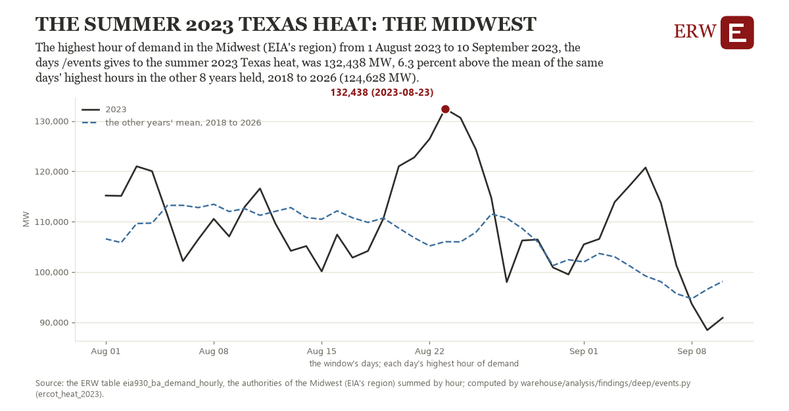

# The summer 2023 texas heat: the Midwest (EIA's region)

Draft `scan-deep-cfa6f85b5301` of the findings hunt (chain 502), 2026-11-19. State: draft, not reviewed. Review at `/internal/findings`.

**The finding.** The highest hour of demand in the Midwest (EIA's region) from 1 August 2023 to 10 September 2023, the days /events gives to the summer 2023 Texas heat, was 132,438 MW, 6.3 percent above the mean of the same days' highest hours in the other 8 years held, 2018 to 2026 (124,628 MW).

**The figure by year** (the window's highest hour of demand, MW): 2018: 122,300, 2019: 119,183, 2020: 123,035, 2021: 125,699, 2022: 119,536, 2023: 132,438, 2024: 129,798, 2025: 126,018, 2026: 131,458.

**The tables and rows.** `eia930_ba_demand_hourly`; the authorities of the Midwest (EIA's region) summed by hour, the hours from 08-01 to 09-10 of each year. The yearly values: `ercot-heat-2023-midw.csv`.

**Its strength.** The gap is 1.53 typical spreads of the other years. The extreme of the years held: 2023's figure is 132,438 MW; the highest other year's is 131,458 MW. Clear by a typical spread: the distance from the other years' mean is 7,810 MW against a typical spread of 5,113 MW. Sample large enough: 8 other years each hold at least 90 percent of the window's hours; 2023 holds 984 of 984. Holds against the median: the distance from the other years' median is 8,071 MW. Not one hour: the window's third-highest hour is 98.9 percent of its highest.

**Its limits.** EIA-930 demand as the authorities filed it, summed by region (an hour held only when every authority filing demand that month holds it); demand served during a load shed is load served, a floor on what was wanted; the same calendar days in UTC of the other years, not the weekday-aligned baseline of the /events pages.

**Reproduce.** `python ercot-heat-2023-midw.reproduce.py <eia930_ba_demand_hourly.csv>` and `do ercot-heat-2023-midw.reproduce.do` (Stata) recompute every year's figure; each names the expected values at its top, and the claim's mean of the other years.
