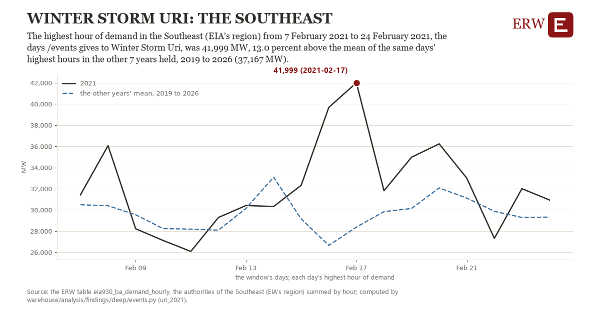

# Winter storm uri: the Southeast (EIA's region)

Draft `scan-deep-760854da4476` of the findings hunt (chain 502), 2026-11-19. State: draft, not reviewed. Review at `/internal/findings`.

**The finding.** The highest hour of demand in the Southeast (EIA's region) from 7 February 2021 to 24 February 2021, the days /events gives to Winter Storm Uri, was 41,999 MW, 13.0 percent above the mean of the same days' highest hours in the other 7 years held, 2019 to 2026 (37,167 MW).

**The figure by year** (the window's highest hour of demand, MW): 2019: 34,323, 2020: 35,487, 2021: 41,999, 2022: 39,028, 2023: 33,491, 2024: 35,369, 2025: 41,499, 2026: 40,970.

**The tables and rows.** `eia930_ba_demand_hourly`; the authorities of the Southeast (EIA's region) summed by hour, the hours from 02-07 to 02-24 of each year. The yearly values: `uri-2021-se.csv`.

**Its strength.** The gap is 1.63 typical spreads of the other years. The extreme of the years held: 2021's figure is 41,999 MW; the highest other year's is 41,499 MW. Clear by a typical spread: the distance from the other years' mean is 4,832 MW against a typical spread of 2,959 MW. Sample large enough: 7 other years each hold at least 90 percent of the window's hours; 2021 holds 432 of 432. Holds against the median: the distance from the other years' median is 6,512 MW. Not one hour: the window's third-highest hour is 96.2 percent of its highest.

**Its limits.** EIA-930 demand as the authorities filed it, summed by region (an hour held only when every authority filing demand that month holds it); demand served during a load shed is load served, a floor on what was wanted; the same calendar days in UTC of the other years, not the weekday-aligned baseline of the /events pages.

**Reproduce.** `python uri-2021-se.reproduce.py <eia930_ba_demand_hourly.csv>` and `do uri-2021-se.reproduce.do` (Stata) recompute every year's figure; each names the expected values at its top, and the claim's mean of the other years.
