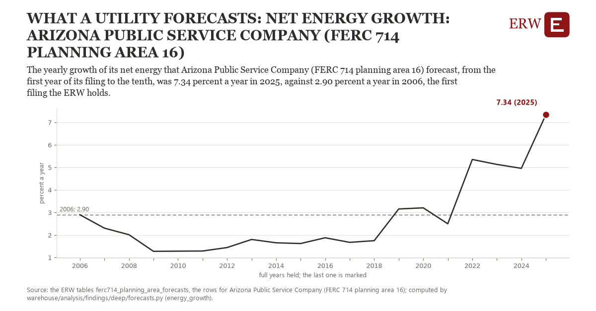

# What a utility forecasts: net energy growth: Arizona Public Service Company (FERC 714 planning area 16)

Draft `scan-deep-db5b815d848d` of the findings hunt over the whole warehouse (chain 502), 2026-11-19. State: draft, not reviewed. Review at `/internal/findings`.

**The finding.** The yearly growth of its net energy that Arizona Public Service Company (FERC 714 planning area 16) forecast, from the first year of its filing to the tenth, was 7.34 percent a year in 2025, against 2.90 percent a year in 2006, the first filing the ERW holds.

**The figure by full year** (percent a year): 2006: 2.90, 2007: 2.30, 2008: 2.01, 2009: 1.28, 2010: 1.28, 2011: 1.29, 2012: 1.44, 2013: 1.80, 2014: 1.65, 2015: 1.62, 2016: 1.88, 2017: 1.67, 2018: 1.75, 2019: 3.16, 2020: 3.21, 2021: 2.50, 2022: 5.35, 2023: 5.13, 2024: 4.96, 2025: 7.34.

**The tables and rows.** `ferc714_planning_area_forecasts`; the rows for Arizona Public Service Company (FERC 714 planning area 16), region key `pa_16` (the card's `hunt.region`), years 2006 to 2025. The yearly values: `energy-growth-pa-16.csv`.

**Its strength.** The change is 13.70 typical yearly moves (a typical move is 0.32 percent a year, 1.4826 times the median absolute change between full years). Holds in more than one year: 6 of the 19 full years after 2006 lie above 2006's value. Survives a change of window: from 2007 to 2025 the change is 5.03, from 2006 to 2024 it is 2.06. Sample large enough: 2006 holds 1 and 2025 holds 1 observations; the floor is 1. Half the change remains without the first year: from 2007 to 2025 the change is 5.03, 113.4 percent of the change from 2006. At least one typical yearly move: the change is 13.70 typical yearly moves (0.32 percent a year a year, the median move between full years); the floor is 1.

**Its limits.** The planning area's own forecast as filed in FERC Form 714 (through PUDL), not an outcome; a filing's ten years start the year after its report year; areas overlap, so nothing is added across them; a filing whose tenth year is over three times or under half its first is left out.

**Reproduce.** `python energy-growth-pa-16.reproduce.py <the table's CSV>` and `do energy-growth-pa-16.reproduce.do` (Stata) recompute the figures by year from the tables as the public downloads hold them; each names the expected values at its top.
