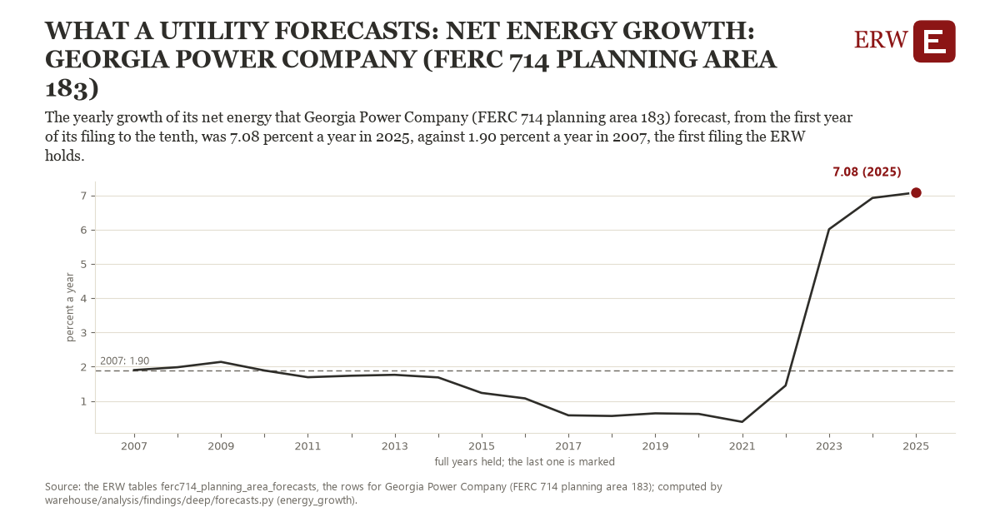

# What a utility forecasts: net energy growth: Georgia Power Company (FERC 714 planning area 183)

Draft `scan-deep-67c9a7d7f911` of the findings hunt over the whole warehouse (chain 502), 2026-11-19. State: draft, not reviewed. Review at `/internal/findings`.

**The finding.** The yearly growth of its net energy that Georgia Power Company (FERC 714 planning area 183) forecast, from the first year of its filing to the tenth, was 7.08 percent a year in 2025, against 1.90 percent a year in 2007, the first filing the ERW holds.

**The figure by full year** (percent a year): 2007: 1.90, 2008: 1.98, 2009: 2.14, 2010: 1.89, 2011: 1.69, 2012: 1.74, 2013: 1.76, 2014: 1.69, 2015: 1.23, 2016: 1.07, 2017: 0.58, 2018: 0.56, 2019: 0.64, 2020: 0.62, 2021: 0.39, 2022: 1.45, 2023: 6.01, 2024: 6.92, 2025: 7.08.

**The tables and rows.** `ferc714_planning_area_forecasts`; the rows for Georgia Power Company (FERC 714 planning area 183), region key `pa_183` (the card's `hunt.region`), years 2007 to 2025. The yearly values: `energy-growth-pa-183.csv`.

**Its strength.** The change is 22.02 typical yearly moves (a typical move is 0.24 percent a year, 1.4826 times the median absolute change between full years). Holds in more than one year: 5 of the 18 full years after 2007 lie above 2007's value. Survives a change of window: from 2008 to 2025 the change is 5.09, from 2007 to 2024 it is 5.02. Sample large enough: 2007 holds 1 and 2025 holds 1 observations; the floor is 1. Half the change remains without the first year: from 2008 to 2025 the change is 5.09, 98.4 percent of the change from 2007. At least one typical yearly move: the change is 22.02 typical yearly moves (0.24 percent a year a year, the median move between full years); the floor is 1.

**Its limits.** The planning area's own forecast as filed in FERC Form 714 (through PUDL), not an outcome; a filing's ten years start the year after its report year; areas overlap, so nothing is added across them; a filing whose tenth year is over three times or under half its first is left out.

**Reproduce.** `python energy-growth-pa-183.reproduce.py <the table's CSV>` and `do energy-growth-pa-183.reproduce.do` (Stata) recompute the figures by year from the tables as the public downloads hold them; each names the expected values at its top.
