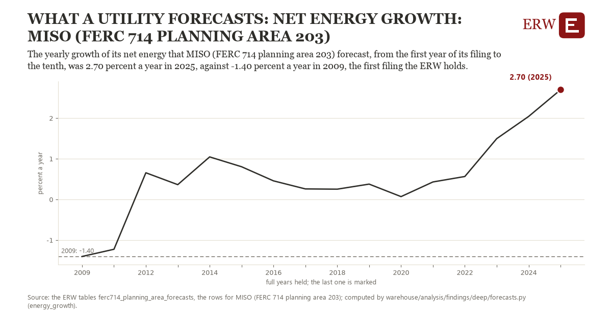

# What a utility forecasts: net energy growth: MISO (FERC 714 planning area 203)

Draft `scan-deep-5babf7fbb462` of the findings hunt over the whole warehouse (chain 502), 2026-11-19. State: draft, not reviewed. Review at `/internal/findings`.

**The finding.** The yearly growth of its net energy that MISO (FERC 714 planning area 203) forecast, from the first year of its filing to the tenth, was 2.70 percent a year in 2025, against -1.40 percent a year in 2009, the first filing the ERW holds.

**The figure by full year** (percent a year): 2009: -1.40, 2011: -1.23, 2012: 0.66, 2013: 0.36, 2014: 1.05, 2015: 0.80, 2016: 0.46, 2017: 0.26, 2018: 0.25, 2019: 0.38, 2020: 0.07, 2021: 0.43, 2022: 0.56, 2023: 1.49, 2024: 2.04, 2025: 2.70.

**The tables and rows.** `ferc714_planning_area_forecasts`; the rows for MISO (FERC 714 planning area 203), region key `pa_203` (the card's `hunt.region`), years 2009 to 2025. The yearly values: `energy-growth-pa-203.csv`.

**Its strength.** The change is 8.99 typical yearly moves (a typical move is 0.46 percent a year, 1.4826 times the median absolute change between full years). Holds in more than one year: 15 of the 15 full years after 2009 lie above 2009's value. Survives a change of window: from 2011 to 2025 the change is 3.92, from 2009 to 2024 it is 3.44. Sample large enough: 2009 holds 1 and 2025 holds 1 observations; the floor is 1. Half the change remains without the first year: from 2011 to 2025 the change is 3.92, 95.7 percent of the change from 2009. At least one typical yearly move: the change is 8.99 typical yearly moves (0.46 percent a year a year, the median move between full years); the floor is 1.

**Its limits.** The planning area's own forecast as filed in FERC Form 714 (through PUDL), not an outcome; a filing's ten years start the year after its report year; areas overlap, so nothing is added across them; a filing whose tenth year is over three times or under half its first is left out.

**Reproduce.** `python energy-growth-pa-203.reproduce.py <the table's CSV>` and `do energy-growth-pa-203.reproduce.do` (Stata) recompute the figures by year from the tables as the public downloads hold them; each names the expected values at its top.
