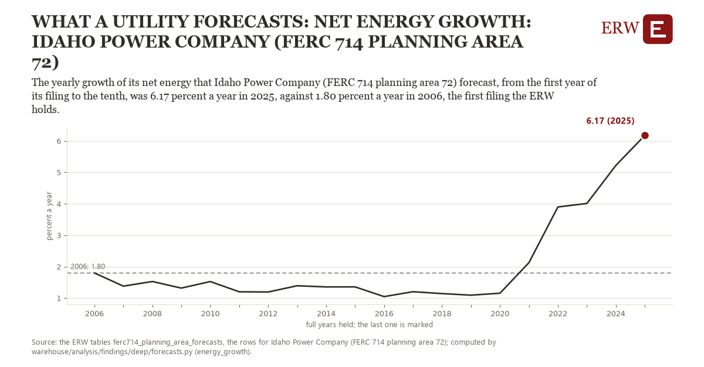

# What a utility forecasts: net energy growth: Idaho Power Company (FERC 714 planning area 72)

Draft `scan-deep-cf436ef0d0c2` of the findings hunt over the whole warehouse (chain 502), 2026-11-19. State: draft, not reviewed. Review at `/internal/findings`.

**The finding.** The yearly growth of its net energy that Idaho Power Company (FERC 714 planning area 72) forecast, from the first year of its filing to the tenth, was 6.17 percent a year in 2025, against 1.80 percent a year in 2006, the first filing the ERW holds.

**The figure by full year** (percent a year): 2006: 1.80, 2007: 1.38, 2008: 1.53, 2009: 1.32, 2010: 1.53, 2011: 1.20, 2012: 1.20, 2013: 1.39, 2014: 1.36, 2015: 1.36, 2016: 1.05, 2017: 1.20, 2018: 1.14, 2019: 1.09, 2020: 1.16, 2021: 2.13, 2022: 3.90, 2023: 4.01, 2024: 5.22, 2025: 6.17.

**The tables and rows.** `ferc714_planning_area_forecasts`; the rows for Idaho Power Company (FERC 714 planning area 72), region key `pa_72` (the card's `hunt.region`), years 2006 to 2025. The yearly values: `energy-growth-pa-72.csv`.

**Its strength.** The change is 14.88 typical yearly moves (a typical move is 0.29 percent a year, 1.4826 times the median absolute change between full years). Holds in more than one year: 5 of the 19 full years after 2006 lie above 2006's value. Survives a change of window: from 2007 to 2025 the change is 4.79, from 2006 to 2024 it is 3.42. Sample large enough: 2006 holds 1 and 2025 holds 1 observations; the floor is 1. Half the change remains without the first year: from 2007 to 2025 the change is 4.79, 109.6 percent of the change from 2006. At least one typical yearly move: the change is 14.88 typical yearly moves (0.29 percent a year a year, the median move between full years); the floor is 1.

**Its limits.** The planning area's own forecast as filed in FERC Form 714 (through PUDL), not an outcome; a filing's ten years start the year after its report year; areas overlap, so nothing is added across them; a filing whose tenth year is over three times or under half its first is left out.

**Reproduce.** `python energy-growth-pa-72.reproduce.py <the table's CSV>` and `do energy-growth-pa-72.reproduce.do` (Stata) recompute the figures by year from the tables as the public downloads hold them; each names the expected values at its top.
