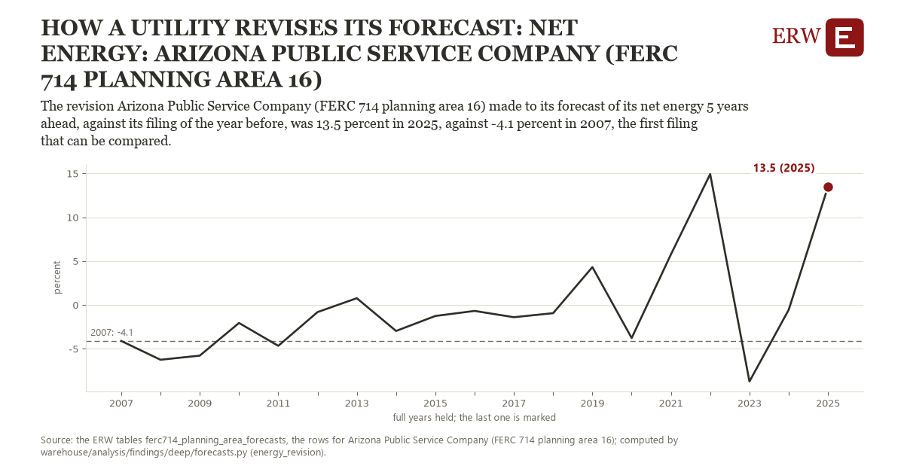

# How a utility revises its forecast: net energy: Arizona Public Service Company (FERC 714 planning area 16)

Draft `scan-deep-fea98bcf9313` of the findings hunt over the whole warehouse (chain 502), 2026-11-19. State: draft, not reviewed. Review at `/internal/findings`.

**The finding.** The revision Arizona Public Service Company (FERC 714 planning area 16) made to its forecast of its net energy 5 years ahead, against its filing of the year before, was 13.5 percent in 2025, against -4.1 percent in 2007, the first filing that can be compared.

**The figure by full year** (percent): 2007: -4.1, 2008: -6.2, 2009: -5.8, 2010: -2.1, 2011: -4.7, 2012: -0.8, 2013: 0.8, 2014: -3.0, 2015: -1.3, 2016: -0.7, 2017: -1.4, 2018: -0.9, 2019: 4.3, 2020: -3.8, 2021: 5.8, 2022: 14.9, 2023: -8.7, 2024: -0.6, 2025: 13.5.

**The tables and rows.** `ferc714_planning_area_forecasts`; the rows for Arizona Public Service Company (FERC 714 planning area 16), region key `pa_16` (the card's `hunt.region`), years 2007 to 2025. The yearly values: `energy-revision-pa-16.csv`.

**Its strength.** The change is 3.18 typical yearly moves (a typical move is 5.5 percent, 1.4826 times the median absolute change between full years). Holds in more than one year: 14 of the 18 full years after 2007 lie above 2007's value. Survives a change of window: from 2008 to 2025 the change is 19.7, from 2007 to 2024 it is 3.6. Sample large enough: 2007 holds 1 and 2025 holds 1 observations; the floor is 1. Half the change remains without the first year: from 2008 to 2025 the change is 19.7, 112.2 percent of the change from 2007. At least one typical yearly move: the change is 3.18 typical yearly moves (5.5 percent a year, the median move between full years); the floor is 1.

**Its limits.** The planning area's own forecast as filed in FERC Form 714 (through PUDL): each filing against the one a year before, for the same year 5 years after the filing; a revision of more than double or less than half is left out (a figure in the wrong unit).

**Reproduce.** `python energy-revision-pa-16.reproduce.py <the table's CSV>` and `do energy-revision-pa-16.reproduce.do` (Stata) recompute the figures by year from the tables as the public downloads hold them; each names the expected values at its top.
