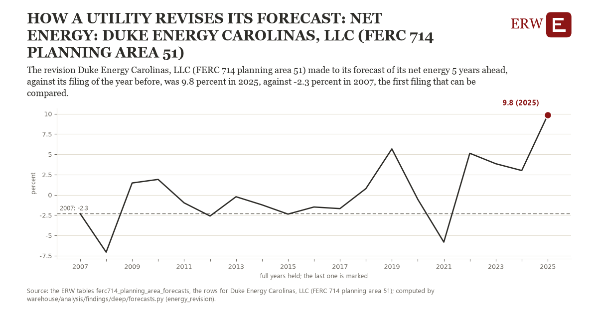

# How a utility revises its forecast: net energy: Duke Energy Carolinas, LLC (FERC 714 planning area 51)

Draft `scan-deep-5db48e6f9a35` of the findings hunt over the whole warehouse (chain 502), 2026-11-19. State: draft, not reviewed. Review at `/internal/findings`.

**The finding.** The revision Duke Energy Carolinas, LLC (FERC 714 planning area 51) made to its forecast of its net energy 5 years ahead, against its filing of the year before, was 9.8 percent in 2025, against -2.3 percent in 2007, the first filing that can be compared.

**The figure by full year** (percent): 2007: -2.3, 2008: -7.1, 2009: 1.5, 2010: 1.9, 2011: -1.0, 2012: -2.6, 2013: -0.2, 2014: -1.2, 2015: -2.4, 2016: -1.5, 2017: -1.7, 2018: 0.8, 2019: 5.7, 2020: -0.6, 2021: -5.8, 2022: 5.1, 2023: 3.8, 2024: 3.0, 2025: 9.8.

**The tables and rows.** `ferc714_planning_area_forecasts`; the rows for Duke Energy Carolinas, LLC (FERC 714 planning area 51), region key `pa_51` (the card's `hunt.region`), years 2007 to 2025. The yearly values: `energy-revision-pa-51.csv`.

**Its strength.** The change is 3.39 typical yearly moves (a typical move is 3.6 percent, 1.4826 times the median absolute change between full years). Holds in more than one year: 14 of the 18 full years after 2007 lie above 2007's value. Survives a change of window: from 2008 to 2025 the change is 16.9, from 2007 to 2024 it is 5.3. Sample large enough: 2007 holds 1 and 2025 holds 1 observations; the floor is 1. Half the change remains without the first year: from 2008 to 2025 the change is 16.9, 139.0 percent of the change from 2007. At least one typical yearly move: the change is 3.39 typical yearly moves (3.6 percent a year, the median move between full years); the floor is 1.

**Its limits.** The planning area's own forecast as filed in FERC Form 714 (through PUDL): each filing against the one a year before, for the same year 5 years after the filing; a revision of more than double or less than half is left out (a figure in the wrong unit).

**Reproduce.** `python energy-revision-pa-51.reproduce.py <the table's CSV>` and `do energy-revision-pa-51.reproduce.do` (Stata) recompute the figures by year from the tables as the public downloads hold them; each names the expected values at its top.
