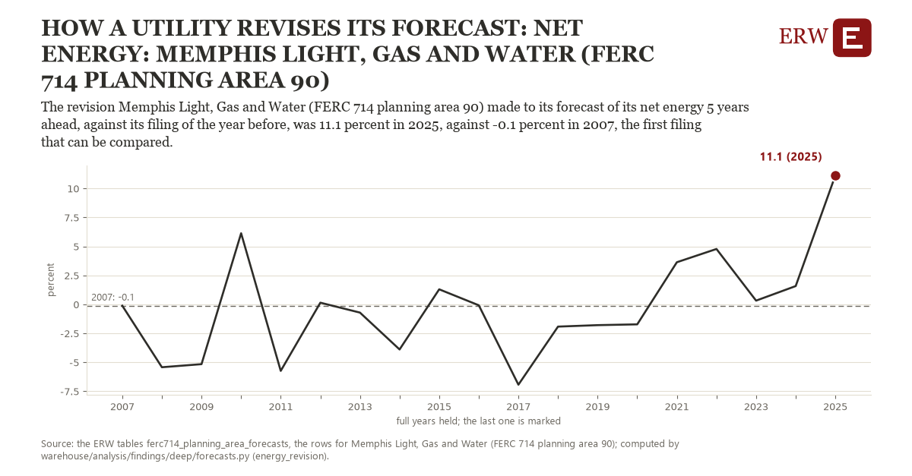

# How a utility revises its forecast: net energy: Memphis Light, Gas and Water (FERC 714 planning area 90)

Draft `scan-deep-d182382892ea` of the findings hunt over the whole warehouse (chain 502), 2026-11-19. State: draft, not reviewed. Review at `/internal/findings`.

**The finding.** The revision Memphis Light, Gas and Water (FERC 714 planning area 90) made to its forecast of its net energy 5 years ahead, against its filing of the year before, was 11.1 percent in 2025, against -0.1 percent in 2007, the first filing that can be compared.

**The figure by full year** (percent): 2007: -0.1, 2008: -5.4, 2009: -5.2, 2010: 6.1, 2011: -5.7, 2012: 0.1, 2013: -0.7, 2014: -3.9, 2015: 1.3, 2016: -0.1, 2017: -6.9, 2018: -1.9, 2019: -1.8, 2020: -1.7, 2021: 3.6, 2022: 4.8, 2023: 0.3, 2024: 1.6, 2025: 11.1.

**The tables and rows.** `ferc714_planning_area_forecasts`; the rows for Memphis Light, Gas and Water (FERC 714 planning area 90), region key `pa_90` (the card's `hunt.region`), years 2007 to 2025. The yearly values: `energy-revision-pa-90.csv`.

**Its strength.** The change is 1.60 typical yearly moves (a typical move is 7.0 percent, 1.4826 times the median absolute change between full years). Holds in more than one year: 9 of the 18 full years after 2007 lie above 2007's value. Survives a change of window: from 2008 to 2025 the change is 16.5, from 2007 to 2024 it is 1.7. Sample large enough: 2007 holds 1 and 2025 holds 1 observations; the floor is 1. Half the change remains without the first year: from 2008 to 2025 the change is 16.5, 147.3 percent of the change from 2007. At least one typical yearly move: the change is 1.60 typical yearly moves (7.0 percent a year, the median move between full years); the floor is 1.

**Its limits.** The planning area's own forecast as filed in FERC Form 714 (through PUDL): each filing against the one a year before, for the same year 5 years after the filing; a revision of more than double or less than half is left out (a figure in the wrong unit).

**Reproduce.** `python energy-revision-pa-90.reproduce.py <the table's CSV>` and `do energy-revision-pa-90.reproduce.do` (Stata) recompute the figures by year from the tables as the public downloads hold them; each names the expected values at its top.
