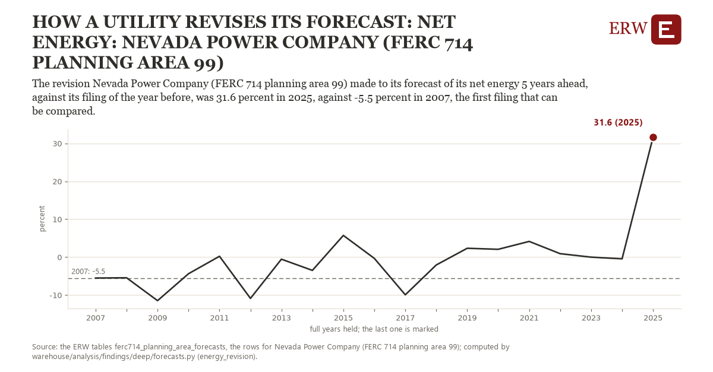

# How a utility revises its forecast: net energy: Nevada Power Company (FERC 714 planning area 99)

Draft `scan-deep-e5d88216e30d` of the findings hunt over the whole warehouse (chain 502), 2026-11-19. State: draft, not reviewed. Review at `/internal/findings`.

**The finding.** The revision Nevada Power Company (FERC 714 planning area 99) made to its forecast of its net energy 5 years ahead, against its filing of the year before, was 31.6 percent in 2025, against -5.5 percent in 2007, the first filing that can be compared.

**The figure by full year** (percent): 2007: -5.5, 2008: -5.4, 2009: -11.5, 2010: -4.4, 2011: 0.2, 2012: -10.9, 2013: -0.5, 2014: -3.5, 2015: 5.7, 2016: -0.3, 2017: -9.9, 2018: -2.1, 2019: 2.3, 2020: 2.1, 2021: 4.1, 2022: 0.9, 2023: 0.0, 2024: -0.4, 2025: 31.6.

**The tables and rows.** `ferc714_planning_area_forecasts`; the rows for Nevada Power Company (FERC 714 planning area 99), region key `pa_99` (the card's `hunt.region`), years 2007 to 2025. The yearly values: `energy-revision-pa-99.csv`.

**Its strength.** The change is 4.71 typical yearly moves (a typical move is 7.9 percent, 1.4826 times the median absolute change between full years). Holds in more than one year: 15 of the 18 full years after 2007 lie above 2007's value. Survives a change of window: from 2008 to 2025 the change is 37.1, from 2007 to 2024 it is 5.1. Sample large enough: 2007 holds 1 and 2025 holds 1 observations; the floor is 1. Half the change remains without the first year: from 2008 to 2025 the change is 37.1, 99.8 percent of the change from 2007. At least one typical yearly move: the change is 4.71 typical yearly moves (7.9 percent a year, the median move between full years); the floor is 1.

**Its limits.** The planning area's own forecast as filed in FERC Form 714 (through PUDL): each filing against the one a year before, for the same year 5 years after the filing; a revision of more than double or less than half is left out (a figure in the wrong unit).

**Reproduce.** `python energy-revision-pa-99.reproduce.py <the table's CSV>` and `do energy-revision-pa-99.reproduce.do` (Stata) recompute the figures by year from the tables as the public downloads hold them; each names the expected values at its top.
