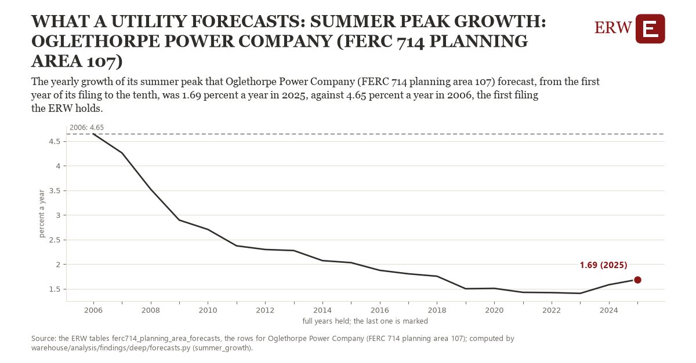

# What a utility forecasts: summer peak growth: Oglethorpe Power Company (FERC 714 planning area 107)

Draft `scan-deep-943a409f7b1e` of the findings hunt over the whole warehouse (chain 502), 2026-11-19. State: draft, not reviewed. Review at `/internal/findings`.

**The finding.** The yearly growth of its summer peak that Oglethorpe Power Company (FERC 714 planning area 107) forecast, from the first year of its filing to the tenth, was 1.69 percent a year in 2025, against 4.65 percent a year in 2006, the first filing the ERW holds.

**The figure by full year** (percent a year): 2006: 4.65, 2007: 4.26, 2008: 3.53, 2009: 2.90, 2010: 2.71, 2011: 2.37, 2012: 2.30, 2013: 2.28, 2014: 2.07, 2015: 2.03, 2016: 1.88, 2017: 1.81, 2018: 1.76, 2019: 1.50, 2020: 1.51, 2021: 1.43, 2022: 1.42, 2023: 1.41, 2024: 1.58, 2025: 1.69.

**The tables and rows.** `ferc714_planning_area_forecasts`; the rows for Oglethorpe Power Company (FERC 714 planning area 107), region key `pa_107` (the card's `hunt.region`), years 2006 to 2025. The yearly values: `summer-growth-pa-107.csv`.

**Its strength.** The change is 18.72 typical yearly moves (a typical move is 0.16 percent a year, 1.4826 times the median absolute change between full years). Holds in more than one year: 19 of the 19 full years after 2006 lie below 2006's value. Survives a change of window: from 2007 to 2025 the change is -2.57, from 2006 to 2024 it is -3.06. Sample large enough: 2006 holds 1 and 2025 holds 1 observations; the floor is 1. Half the change remains without the first year: from 2007 to 2025 the change is -2.57, 86.9 percent of the change from 2006. At least one typical yearly move: the change is 18.72 typical yearly moves (0.16 percent a year a year, the median move between full years); the floor is 1.

**Its limits.** The planning area's own forecast as filed in FERC Form 714 (through PUDL), not an outcome; a filing's ten years start the year after its report year; areas overlap, so nothing is added across them; a filing whose tenth year is over three times or under half its first is left out.

**Reproduce.** `python summer-growth-pa-107.reproduce.py <the table's CSV>` and `do summer-growth-pa-107.reproduce.do` (Stata) recompute the figures by year from the tables as the public downloads hold them; each names the expected values at its top.
