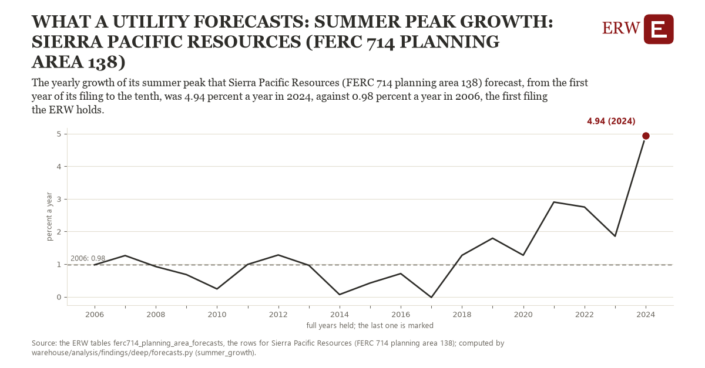

# What a utility forecasts: summer peak growth: Sierra Pacific Resources (FERC 714 planning area 138)

Draft `scan-deep-892470772209` of the findings hunt over the whole warehouse (chain 502), 2026-11-19. State: draft, not reviewed. Review at `/internal/findings`.

**The finding.** The yearly growth of its summer peak that Sierra Pacific Resources (FERC 714 planning area 138) forecast, from the first year of its filing to the tenth, was 4.94 percent a year in 2024, against 0.98 percent a year in 2006, the first filing the ERW holds.

**The figure by full year** (percent a year): 2006: 0.98, 2007: 1.26, 2008: 0.93, 2009: 0.68, 2010: 0.24, 2011: 0.99, 2012: 1.28, 2013: 0.96, 2014: 0.07, 2015: 0.42, 2016: 0.71, 2017: -0.02, 2018: 1.27, 2019: 1.79, 2020: 1.27, 2021: 2.90, 2022: 2.75, 2023: 1.86, 2024: 4.94.

**The tables and rows.** `ferc714_planning_area_forecasts`; the rows for Sierra Pacific Resources (FERC 714 planning area 138), region key `pa_138` (the card's `hunt.region`), years 2006 to 2024. The yearly values: `summer-growth-pa-138.csv`.

**Its strength.** The change is 5.55 typical yearly moves (a typical move is 0.71 percent a year, 1.4826 times the median absolute change between full years). Holds in more than one year: 10 of the 18 full years after 2006 lie above 2006's value. Survives a change of window: from 2007 to 2024 the change is 3.67, from 2006 to 2023 it is 0.88. Sample large enough: 2006 holds 1 and 2024 holds 1 observations; the floor is 1. Half the change remains without the first year: from 2007 to 2024 the change is 3.67, 92.8 percent of the change from 2006. At least one typical yearly move: the change is 5.55 typical yearly moves (0.71 percent a year a year, the median move between full years); the floor is 1.

**Its limits.** The planning area's own forecast as filed in FERC Form 714 (through PUDL), not an outcome; a filing's ten years start the year after its report year; areas overlap, so nothing is added across them; a filing whose tenth year is over three times or under half its first is left out.

**Reproduce.** `python summer-growth-pa-138.reproduce.py <the table's CSV>` and `do summer-growth-pa-138.reproduce.do` (Stata) recompute the figures by year from the tables as the public downloads hold them; each names the expected values at its top.
