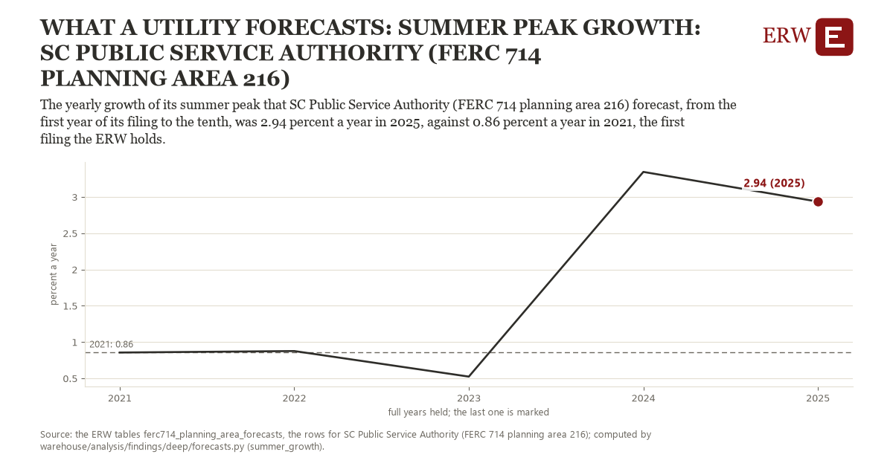

# What a utility forecasts: summer peak growth: SC Public Service Authority (FERC 714 planning area 216)

Draft `scan-deep-a9e0d283dfa9` of the findings hunt over the whole warehouse (chain 502), 2026-11-19. State: draft, not reviewed. Review at `/internal/findings`.

**The finding.** The yearly growth of its summer peak that SC Public Service Authority (FERC 714 planning area 216) forecast, from the first year of its filing to the tenth, was 2.94 percent a year in 2025, against 0.86 percent a year in 2021, the first filing the ERW holds.

**The figure by full year** (percent a year): 2021: 0.86, 2022: 0.88, 2023: 0.52, 2024: 3.35, 2025: 2.94.

**The tables and rows.** `ferc714_planning_area_forecasts`; the rows for SC Public Service Authority (FERC 714 planning area 216), region key `pa_216` (the card's `hunt.region`), years 2021 to 2025. The yearly values: `summer-growth-pa-216.csv`.

**Its strength.** The change is 3.68 typical yearly moves (a typical move is 0.56 percent a year, 1.4826 times the median absolute change between full years). Holds in more than one year: 3 of the 4 full years after 2021 lie above 2021's value. Survives a change of window: from 2022 to 2025 the change is 2.06, from 2021 to 2024 it is 2.49. Sample large enough: 2021 holds 1 and 2025 holds 1 observations; the floor is 1. Half the change remains without the first year: from 2022 to 2025 the change is 2.06, 99.0 percent of the change from 2021. At least one typical yearly move: the change is 3.68 typical yearly moves (0.56 percent a year a year, the median move between full years); the floor is 1.

**Its limits.** The planning area's own forecast as filed in FERC Form 714 (through PUDL), not an outcome; a filing's ten years start the year after its report year; areas overlap, so nothing is added across them; a filing whose tenth year is over three times or under half its first is left out.

**Reproduce.** `python summer-growth-pa-216.reproduce.py <the table's CSV>` and `do summer-growth-pa-216.reproduce.do` (Stata) recompute the figures by year from the tables as the public downloads hold them; each names the expected values at its top.
