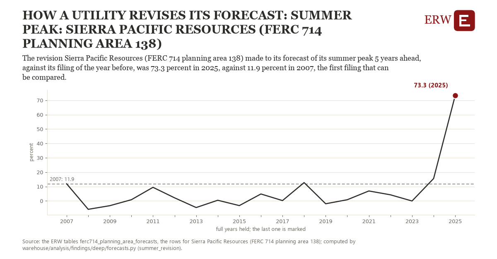

# How a utility revises its forecast: summer peak: Sierra Pacific Resources (FERC 714 planning area 138)

Draft `scan-deep-b14ed0c2b39d` of the findings hunt over the whole warehouse (chain 502), 2026-11-19. State: draft, not reviewed. Review at `/internal/findings`.

**The finding.** The revision Sierra Pacific Resources (FERC 714 planning area 138) made to its forecast of its summer peak 5 years ahead, against its filing of the year before, was 73.3 percent in 2025, against 11.9 percent in 2007, the first filing that can be compared.

**The figure by full year** (percent): 2007: 11.9, 2008: -5.9, 2009: -3.3, 2010: 0.8, 2011: 9.4, 2012: 2.1, 2013: -4.6, 2014: 0.4, 2015: -3.3, 2016: 4.8, 2017: 0.2, 2018: 12.7, 2019: -2.0, 2020: 0.8, 2021: 6.9, 2022: 4.2, 2023: -0.1, 2024: 15.6, 2025: 73.3.

**The tables and rows.** `ferc714_planning_area_forecasts`; the rows for Sierra Pacific Resources (FERC 714 planning area 138), region key `pa_138` (the card's `hunt.region`), years 2007 to 2025. The yearly values: `summer-revision-pa-138.csv`.

**Its strength.** The change is 6.44 typical yearly moves (a typical move is 9.5 percent, 1.4826 times the median absolute change between full years). Holds in more than one year: 3 of the 18 full years after 2007 lie above 2007's value. Survives a change of window: from 2008 to 2025 the change is 79.2, from 2007 to 2024 it is 3.7. Sample large enough: 2007 holds 1 and 2025 holds 1 observations; the floor is 1. Half the change remains without the first year: from 2008 to 2025 the change is 79.2, 128.9 percent of the change from 2007. At least one typical yearly move: the change is 6.44 typical yearly moves (9.5 percent a year, the median move between full years); the floor is 1.

**Its limits.** The planning area's own forecast as filed in FERC Form 714 (through PUDL): each filing against the one a year before, for the same year 5 years after the filing; a revision of more than double or less than half is left out (a figure in the wrong unit).

**Reproduce.** `python summer-revision-pa-138.reproduce.py <the table's CSV>` and `do summer-revision-pa-138.reproduce.do` (Stata) recompute the figures by year from the tables as the public downloads hold them; each names the expected values at its top.
