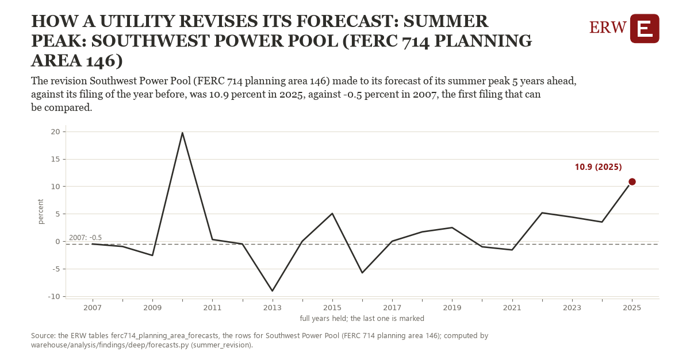

# How a utility revises its forecast: summer peak: Southwest Power Pool (FERC 714 planning area 146)

Draft `scan-deep-0e6bf1f40748` of the findings hunt over the whole warehouse (chain 502), 2026-11-19. State: draft, not reviewed. Review at `/internal/findings`.

**The finding.** The revision Southwest Power Pool (FERC 714 planning area 146) made to its forecast of its summer peak 5 years ahead, against its filing of the year before, was 10.9 percent in 2025, against -0.5 percent in 2007, the first filing that can be compared.

**The figure by full year** (percent): 2007: -0.5, 2008: -1.0, 2009: -2.6, 2010: 19.7, 2011: 0.3, 2012: -0.5, 2013: -9.1, 2014: 0.0, 2015: 5.0, 2016: -5.8, 2017: 0.0, 2018: 1.7, 2019: 2.5, 2020: -1.0, 2021: -1.6, 2022: 5.2, 2023: 4.4, 2024: 3.5, 2025: 10.9.

**The tables and rows.** `ferc714_planning_area_forecasts`; the rows for Southwest Power Pool (FERC 714 planning area 146), region key `pa_146` (the card's `hunt.region`), years 2007 to 2025. The yearly values: `summer-revision-pa-146.csv`.

**Its strength.** The change is 1.81 typical yearly moves (a typical move is 6.3 percent, 1.4826 times the median absolute change between full years). Holds in more than one year: 12 of the 18 full years after 2007 lie above 2007's value. Survives a change of window: from 2008 to 2025 the change is 11.9, from 2007 to 2024 it is 4.0. Sample large enough: 2007 holds 1 and 2025 holds 1 observations; the floor is 1. Half the change remains without the first year: from 2008 to 2025 the change is 11.9, 103.9 percent of the change from 2007. At least one typical yearly move: the change is 1.81 typical yearly moves (6.3 percent a year, the median move between full years); the floor is 1.

**Its limits.** The planning area's own forecast as filed in FERC Form 714 (through PUDL): each filing against the one a year before, for the same year 5 years after the filing; a revision of more than double or less than half is left out (a figure in the wrong unit).

**Reproduce.** `python summer-revision-pa-146.reproduce.py <the table's CSV>` and `do summer-revision-pa-146.reproduce.do` (Stata) recompute the figures by year from the tables as the public downloads hold them; each names the expected values at its top.
