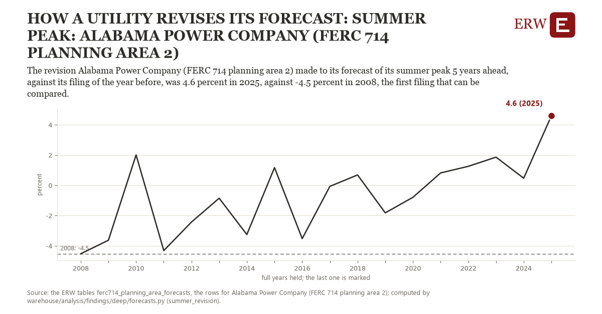

# How a utility revises its forecast: summer peak: Alabama Power Company (FERC 714 planning area 2)

Draft `scan-deep-cf539de868d7` of the findings hunt over the whole warehouse (chain 502), 2026-11-19. State: draft, not reviewed. Review at `/internal/findings`.

**The finding.** The revision Alabama Power Company (FERC 714 planning area 2) made to its forecast of its summer peak 5 years ahead, against its filing of the year before, was 4.6 percent in 2025, against -4.5 percent in 2008, the first filing that can be compared.

**The figure by full year** (percent): 2008: -4.5, 2009: -3.6, 2010: 2.0, 2011: -4.3, 2012: -2.4, 2013: -0.9, 2014: -3.3, 2015: 1.2, 2016: -3.5, 2017: -0.1, 2018: 0.7, 2019: -1.8, 2020: -0.8, 2021: 0.8, 2022: 1.3, 2023: 1.9, 2024: 0.5, 2025: 4.6.

**The tables and rows.** `ferc714_planning_area_forecasts`; the rows for Alabama Power Company (FERC 714 planning area 2), region key `pa_2` (the card's `hunt.region`), years 2008 to 2025. The yearly values: `summer-revision-pa-2.csv`.

**Its strength.** The change is 3.26 typical yearly moves (a typical move is 2.8 percent, 1.4826 times the median absolute change between full years). Holds in more than one year: 17 of the 17 full years after 2008 lie above 2008's value. Survives a change of window: from 2009 to 2025 the change is 8.2, from 2008 to 2024 it is 5.0. Sample large enough: 2008 holds 1 and 2025 holds 1 observations; the floor is 1. Half the change remains without the first year: from 2009 to 2025 the change is 8.2, 90.2 percent of the change from 2008. At least one typical yearly move: the change is 3.26 typical yearly moves (2.8 percent a year, the median move between full years); the floor is 1.

**Its limits.** The planning area's own forecast as filed in FERC Form 714 (through PUDL): each filing against the one a year before, for the same year 5 years after the filing; a revision of more than double or less than half is left out (a figure in the wrong unit).

**Reproduce.** `python summer-revision-pa-2.reproduce.py <the table's CSV>` and `do summer-revision-pa-2.reproduce.do` (Stata) recompute the figures by year from the tables as the public downloads hold them; each names the expected values at its top.
