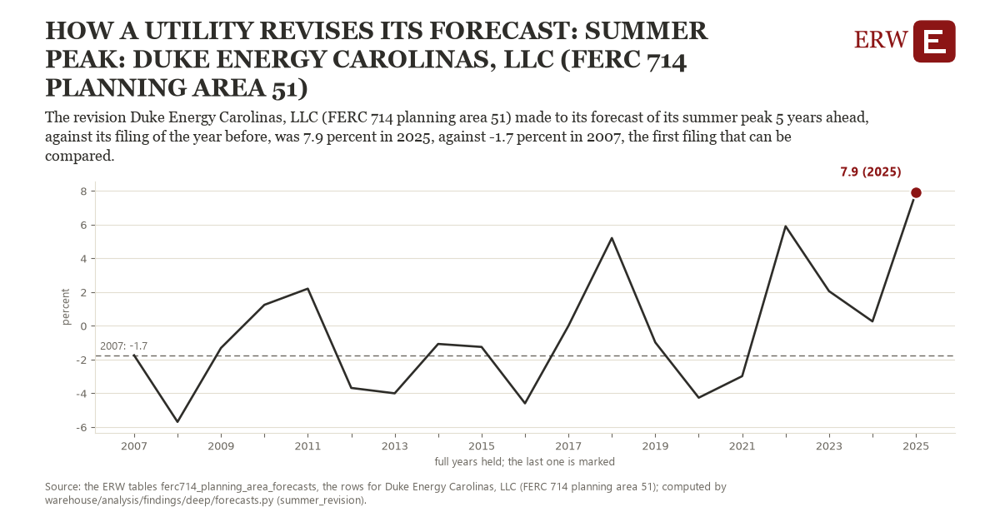

# How a utility revises its forecast: summer peak: Duke Energy Carolinas, LLC (FERC 714 planning area 51)

Draft `scan-deep-bffc70ff1a51` of the findings hunt over the whole warehouse (chain 502), 2026-11-19. State: draft, not reviewed. Review at `/internal/findings`.

**The finding.** The revision Duke Energy Carolinas, LLC (FERC 714 planning area 51) made to its forecast of its summer peak 5 years ahead, against its filing of the year before, was 7.9 percent in 2025, against -1.7 percent in 2007, the first filing that can be compared.

**The figure by full year** (percent): 2007: -1.7, 2008: -5.7, 2009: -1.3, 2010: 1.2, 2011: 2.2, 2012: -3.7, 2013: -4.0, 2014: -1.1, 2015: -1.2, 2016: -4.6, 2017: 0.0, 2018: 5.2, 2019: -1.0, 2020: -4.3, 2021: -3.0, 2022: 5.9, 2023: 2.1, 2024: 0.3, 2025: 7.9.

**The tables and rows.** `ferc714_planning_area_forecasts`; the rows for Duke Energy Carolinas, LLC (FERC 714 planning area 51), region key `pa_51` (the card's `hunt.region`), years 2007 to 2025. The yearly values: `summer-revision-pa-51.csv`.

**Its strength.** The change is 1.81 typical yearly moves (a typical move is 5.3 percent, 1.4826 times the median absolute change between full years). Holds in more than one year: 12 of the 18 full years after 2007 lie above 2007's value. Survives a change of window: from 2008 to 2025 the change is 13.6, from 2007 to 2024 it is 2.0. Sample large enough: 2007 holds 1 and 2025 holds 1 observations; the floor is 1. Half the change remains without the first year: from 2008 to 2025 the change is 13.6, 140.9 percent of the change from 2007. At least one typical yearly move: the change is 1.81 typical yearly moves (5.3 percent a year, the median move between full years); the floor is 1.

**Its limits.** The planning area's own forecast as filed in FERC Form 714 (through PUDL): each filing against the one a year before, for the same year 5 years after the filing; a revision of more than double or less than half is left out (a figure in the wrong unit).

**Reproduce.** `python summer-revision-pa-51.reproduce.py <the table's CSV>` and `do summer-revision-pa-51.reproduce.do` (Stata) recompute the figures by year from the tables as the public downloads hold them; each names the expected values at its top.
