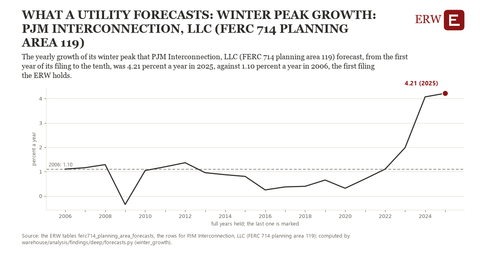

# What a utility forecasts: winter peak growth: PJM Interconnection, LLC (FERC 714 planning area 119)

Draft `scan-deep-af80a863cc26` of the findings hunt over the whole warehouse (chain 502), 2026-11-19. State: draft, not reviewed. Review at `/internal/findings`.

**The finding.** The yearly growth of its winter peak that PJM Interconnection, LLC (FERC 714 planning area 119) forecast, from the first year of its filing to the tenth, was 4.21 percent a year in 2025, against 1.10 percent a year in 2006, the first filing the ERW holds.

**The figure by full year** (percent a year): 2006: 1.10, 2007: 1.16, 2008: 1.29, 2009: -0.35, 2010: 1.04, 2011: 1.20, 2012: 1.36, 2013: 0.95, 2014: 0.87, 2015: 0.80, 2016: 0.25, 2017: 0.37, 2018: 0.40, 2019: 0.65, 2020: 0.32, 2021: 0.70, 2022: 1.10, 2023: 1.99, 2024: 4.07, 2025: 4.21.

**The tables and rows.** `ferc714_planning_area_forecasts`; the rows for PJM Interconnection, LLC (FERC 714 planning area 119), region key `pa_119` (the card's `hunt.region`), years 2006 to 2025. The yearly values: `winter-growth-pa-119.csv`.

**Its strength.** The change is 8.16 typical yearly moves (a typical move is 0.38 percent a year, 1.4826 times the median absolute change between full years). Holds in more than one year: 8 of the 19 full years after 2006 lie above 2006's value. Survives a change of window: from 2007 to 2025 the change is 3.05, from 2006 to 2024 it is 2.97. Sample large enough: 2006 holds 1 and 2025 holds 1 observations; the floor is 1. Half the change remains without the first year: from 2007 to 2025 the change is 3.05, 98.1 percent of the change from 2006. At least one typical yearly move: the change is 8.16 typical yearly moves (0.38 percent a year a year, the median move between full years); the floor is 1.

**Its limits.** The planning area's own forecast as filed in FERC Form 714 (through PUDL), not an outcome; a filing's ten years start the year after its report year; areas overlap, so nothing is added across them; a filing whose tenth year is over three times or under half its first is left out.

**Reproduce.** `python winter-growth-pa-119.reproduce.py <the table's CSV>` and `do winter-growth-pa-119.reproduce.do` (Stata) recompute the figures by year from the tables as the public downloads hold them; each names the expected values at its top.
