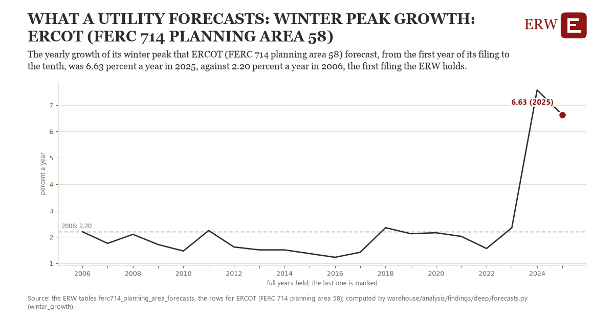

# What a utility forecasts: winter peak growth: ERCOT (FERC 714 planning area 58)

Draft `scan-deep-000629281953` of the findings hunt over the whole warehouse (chain 502), 2026-11-19. State: draft, not reviewed. Review at `/internal/findings`.

**The finding.** The yearly growth of its winter peak that ERCOT (FERC 714 planning area 58) forecast, from the first year of its filing to the tenth, was 6.63 percent a year in 2025, against 2.20 percent a year in 2006, the first filing the ERW holds.

**The figure by full year** (percent a year): 2006: 2.20, 2007: 1.76, 2008: 2.10, 2009: 1.71, 2010: 1.47, 2011: 2.25, 2012: 1.62, 2013: 1.51, 2014: 1.51, 2015: 1.37, 2016: 1.23, 2017: 1.42, 2018: 2.35, 2019: 2.13, 2020: 2.16, 2021: 2.02, 2022: 1.56, 2023: 2.35, 2024: 7.57, 2025: 6.63.

**The tables and rows.** `ferc714_planning_area_forecasts`; the rows for ERCOT (FERC 714 planning area 58), region key `pa_58` (the card's `hunt.region`), years 2006 to 2025. The yearly values: `winter-growth-pa-58.csv`.

**Its strength.** The change is 8.75 typical yearly moves (a typical move is 0.51 percent a year, 1.4826 times the median absolute change between full years). Holds in more than one year: 5 of the 19 full years after 2006 lie above 2006's value. Survives a change of window: from 2007 to 2025 the change is 4.87, from 2006 to 2024 it is 5.36. Sample large enough: 2006 holds 1 and 2025 holds 1 observations; the floor is 1. Half the change remains without the first year: from 2007 to 2025 the change is 4.87, 110.0 percent of the change from 2006. At least one typical yearly move: the change is 8.75 typical yearly moves (0.51 percent a year a year, the median move between full years); the floor is 1.

**Its limits.** The planning area's own forecast as filed in FERC Form 714 (through PUDL), not an outcome; a filing's ten years start the year after its report year; areas overlap, so nothing is added across them; a filing whose tenth year is over three times or under half its first is left out.

**Reproduce.** `python winter-growth-pa-58.reproduce.py <the table's CSV>` and `do winter-growth-pa-58.reproduce.do` (Stata) recompute the figures by year from the tables as the public downloads hold them; each names the expected values at its top.
