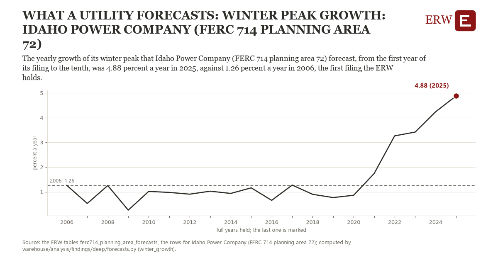

# What a utility forecasts: winter peak growth: Idaho Power Company (FERC 714 planning area 72)

Draft `scan-deep-f08efef24081` of the findings hunt over the whole warehouse (chain 502), 2026-11-19. State: draft, not reviewed. Review at `/internal/findings`.

**The finding.** The yearly growth of its winter peak that Idaho Power Company (FERC 714 planning area 72) forecast, from the first year of its filing to the tenth, was 4.88 percent a year in 2025, against 1.26 percent a year in 2006, the first filing the ERW holds.

**The figure by full year** (percent a year): 2006: 1.26, 2007: 0.53, 2008: 1.25, 2009: 0.26, 2010: 1.02, 2011: 0.97, 2012: 0.90, 2013: 1.02, 2014: 0.93, 2015: 1.16, 2016: 0.65, 2017: 1.27, 2018: 0.90, 2019: 0.77, 2020: 0.86, 2021: 1.74, 2022: 3.26, 2023: 3.41, 2024: 4.23, 2025: 4.88.

**The tables and rows.** `ferc714_planning_area_forecasts`; the rows for Idaho Power Company (FERC 714 planning area 72), region key `pa_72` (the card's `hunt.region`), years 2006 to 2025. The yearly values: `winter-growth-pa-72.csv`.

**Its strength.** The change is 4.82 typical yearly moves (a typical move is 0.75 percent a year, 1.4826 times the median absolute change between full years). Holds in more than one year: 6 of the 19 full years after 2006 lie above 2006's value. Survives a change of window: from 2007 to 2025 the change is 4.35, from 2006 to 2024 it is 2.97. Sample large enough: 2006 holds 1 and 2025 holds 1 observations; the floor is 1. Half the change remains without the first year: from 2007 to 2025 the change is 4.35, 120.3 percent of the change from 2006. At least one typical yearly move: the change is 4.82 typical yearly moves (0.75 percent a year a year, the median move between full years); the floor is 1.

**Its limits.** The planning area's own forecast as filed in FERC Form 714 (through PUDL), not an outcome; a filing's ten years start the year after its report year; areas overlap, so nothing is added across them; a filing whose tenth year is over three times or under half its first is left out.

**Reproduce.** `python winter-growth-pa-72.reproduce.py <the table's CSV>` and `do winter-growth-pa-72.reproduce.do` (Stata) recompute the figures by year from the tables as the public downloads hold them; each names the expected values at its top.
