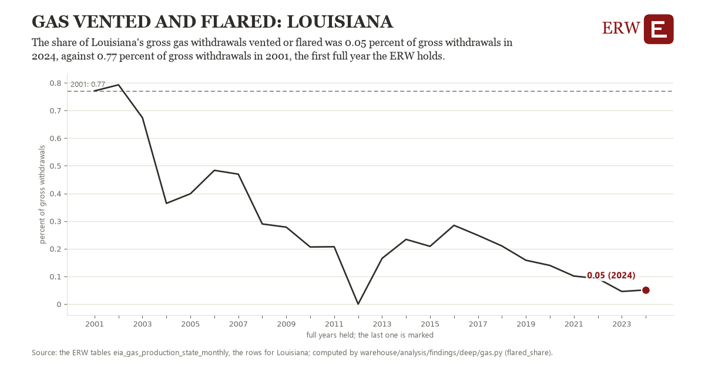

# Gas vented and flared: Louisiana

Draft `scan-deep-4631e32a866a` of the findings hunt over the whole warehouse (chain 164), 2026-11-06. State: draft, not reviewed. Review at `/internal/findings`.

**The finding.** The share of Louisiana's gross gas withdrawals vented or flared was 0.05 percent of gross withdrawals in 2024, against 0.77 percent of gross withdrawals in 2001, the first full year the ERW holds.

**The figure by full year** (percent of gross withdrawals): 2001: 0.77, 2002: 0.79, 2003: 0.67, 2004: 0.36, 2005: 0.40, 2006: 0.48, 2007: 0.47, 2008: 0.29, 2009: 0.28, 2010: 0.21, 2011: 0.21, 2012: 0.00, 2013: 0.17, 2014: 0.23, 2015: 0.21, 2016: 0.28, 2017: 0.25, 2018: 0.21, 2019: 0.16, 2020: 0.14, 2021: 0.10, 2022: 0.09, 2023: 0.05, 2024: 0.05.

**The tables and rows.** `eia_gas_production_state_monthly`; the rows for Louisiana, region key `flare_LA` (the card's `hunt.region`), years 2001 to 2024. The yearly values: `flared-share-flare-la.csv`.

**Its strength.** The change is 12.61 typical yearly moves (a typical move is 0.06 percent of gross withdrawals, 1.4826 times the median absolute change between full years). Holds in more than one year: 22 of the 23 full years after 2001 lie below 2001's value. Survives a change of window: from 2002 to 2024 the change is -0.74, from 2001 to 2023 it is -0.72. Sample large enough: 2001 holds 12 and 2024 holds 12 observations; the floor is 11. Half the change remains without the first year: from 2002 to 2024 the change is -0.74, 103.1 percent of the change from 2001. At least one typical yearly move: the change is 12.61 typical yearly moves (0.06 percent of gross withdrawals a year, the median move between full years); the floor is 1.

**Its limits.** EIA's monthly figures as published, the latest months preliminary and EIA's estimates where a state does not report. Venting and flaring are reported or estimated by the states, and EIA's series ends in 2024; states with less than 100 Bcf of gross withdrawals in their last whole year are not hunted.

**Reproduce.** `python flared-share-flare-la.reproduce.py <the table's CSV>` and `do flared-share-flare-la.reproduce.do` (Stata) recompute the figures by year from the tables as the public downloads hold them; each names the expected values at its top.
