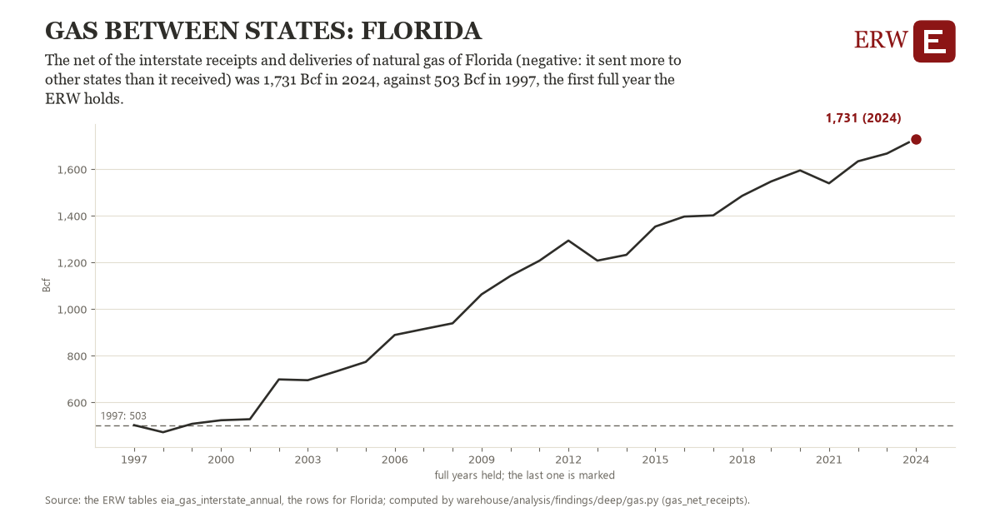

# Gas between states: Florida

Draft `scan-deep-7c4a7d3109e8` of the findings hunt over the whole warehouse (chain 502), 2026-11-19. State: draft, not reviewed. Review at `/internal/findings`.

**The finding.** The net of the interstate receipts and deliveries of natural gas of Florida (negative: it sent more to other states than it received) was 1,731 Bcf in 2024, against 503 Bcf in 1997, the first full year the ERW holds.

**The figure by full year** (Bcf): 1997: 503, 1998: 473, 1999: 509, 2000: 524, 2001: 528, 2002: 699, 2003: 696, 2004: 734, 2005: 774, 2006: 890, 2007: 915, 2008: 940, 2009: 1,064, 2010: 1,143, 2011: 1,208, 2012: 1,295, 2013: 1,209, 2014: 1,233, 2015: 1,355, 2016: 1,398, 2017: 1,402, 2018: 1,486, 2019: 1,548, 2020: 1,596, 2021: 1,540, 2022: 1,635, 2023: 1,668, 2024: 1,731.

**The tables and rows.** `eia_gas_interstate_annual`; the rows for Florida, region key `gn_fl` (the card's `hunt.region`), years 1997 to 2024. The yearly values: `gas-net-receipts-gn-fl.csv`.

**Its strength.** The change is 17.47 typical yearly moves (a typical move is 70 Bcf, 1.4826 times the median absolute change between full years). Holds in more than one year: 26 of the 27 full years after 1997 lie above 1997's value. Survives a change of window: from 1998 to 2024 the change is 1,259, from 1997 to 2023 it is 1,165. Sample large enough: 1997 holds 1 and 2024 holds 1 observations; the floor is 1. Half the change remains without the first year: from 1998 to 2024 the change is 1,259, 102.5 percent of the change from 1997. At least one typical yearly move: the change is 17.47 typical yearly moves (70 Bcf a year, the median move between full years); the floor is 1.

**Its limits.** EIA's interstate movements as reported by the pipelines; a state's net receipts include gas passing through it to other states.

**Reproduce.** `python gas-net-receipts-gn-fl.reproduce.py <the table's CSV>` and `do gas-net-receipts-gn-fl.reproduce.do` (Stata) recompute the figures by year from the tables as the public downloads hold them; each names the expected values at its top.
