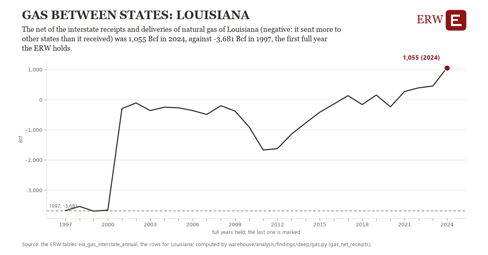

# Gas between states: Louisiana

Draft `scan-deep-682141b37ffd` of the findings hunt over the whole warehouse (chain 502), 2026-11-19. State: draft, not reviewed. Review at `/internal/findings`.

**The finding.** The net of the interstate receipts and deliveries of natural gas of Louisiana (negative: it sent more to other states than it received) was 1,055 Bcf in 2024, against -3,681 Bcf in 1997, the first full year the ERW holds.

**The figure by full year** (Bcf): 1997: -3,681, 1998: -3,543, 1999: -3,699, 2000: -3,663, 2001: -298, 2002: -112, 2003: -364, 2004: -253, 2005: -271, 2006: -363, 2007: -493, 2008: -203, 2009: -380, 2010: -907, 2011: -1,672, 2012: -1,626, 2013: -1,143, 2014: -776, 2015: -418, 2016: -146, 2017: 131, 2018: -165, 2019: 151, 2020: -240, 2021: 269, 2022: 390, 2023: 451, 2024: 1,055.

**The tables and rows.** `eia_gas_interstate_annual`; the rows for Louisiana, region key `gn_la` (the card's `hunt.region`), years 1997 to 2024. The yearly values: `gas-net-receipts-gn-la.csv`.

**Its strength.** The change is 11.78 typical yearly moves (a typical move is 402 Bcf, 1.4826 times the median absolute change between full years). Holds in more than one year: 26 of the 27 full years after 1997 lie above 1997's value. Survives a change of window: from 1998 to 2024 the change is 4,598, from 1997 to 2023 it is 4,132. Sample large enough: 1997 holds 1 and 2024 holds 1 observations; the floor is 1. Half the change remains without the first year: from 1998 to 2024 the change is 4,598, 97.1 percent of the change from 1997. At least one typical yearly move: the change is 11.78 typical yearly moves (402 Bcf a year, the median move between full years); the floor is 1.

**Its limits.** EIA's interstate movements as reported by the pipelines; a state's net receipts include gas passing through it to other states.

**Reproduce.** `python gas-net-receipts-gn-la.reproduce.py <the table's CSV>` and `do gas-net-receipts-gn-la.reproduce.do` (Stata) recompute the figures by year from the tables as the public downloads hold them; each names the expected values at its top.
