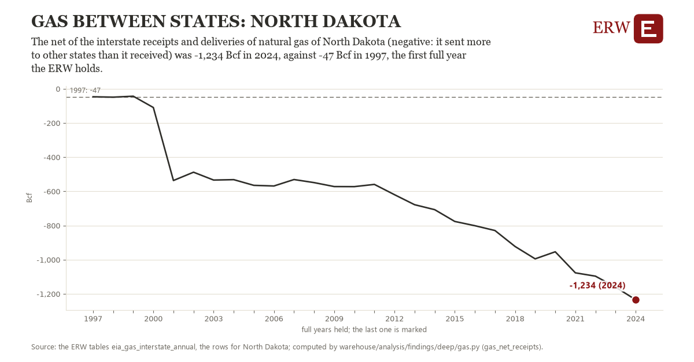

# Gas between states: North Dakota

Draft `scan-deep-bccc7411c1a3` of the findings hunt over the whole warehouse (chain 502), 2026-11-19. State: draft, not reviewed. Review at `/internal/findings`.

**The finding.** The net of the interstate receipts and deliveries of natural gas of North Dakota (negative: it sent more to other states than it received) was -1,234 Bcf in 2024, against -47 Bcf in 1997, the first full year the ERW holds.

**The figure by full year** (Bcf): 1997: -47, 1998: -49, 1999: -43, 2000: -109, 2001: -536, 2002: -488, 2003: -534, 2004: -531, 2005: -565, 2006: -569, 2007: -531, 2008: -549, 2009: -572, 2010: -572, 2011: -559, 2012: -619, 2013: -678, 2014: -707, 2015: -776, 2016: -801, 2017: -829, 2018: -922, 2019: -995, 2020: -953, 2021: -1,077, 2022: -1,096, 2023: -1,160, 2024: -1,234.

**The tables and rows.** `eia_gas_interstate_annual`; the rows for North Dakota, region key `gn_nd` (the card's `hunt.region`), years 1997 to 2024. The yearly values: `gas-net-receipts-gn-nd.csv`.

**Its strength.** The change is 21.20 typical yearly moves (a typical move is 56 Bcf, 1.4826 times the median absolute change between full years). Holds in more than one year: 26 of the 27 full years after 1997 lie below 1997's value. Survives a change of window: from 1998 to 2024 the change is -1,185, from 1997 to 2023 it is -1,114. Sample large enough: 1997 holds 1 and 2024 holds 1 observations; the floor is 1. Half the change remains without the first year: from 1998 to 2024 the change is -1,185, 99.8 percent of the change from 1997. At least one typical yearly move: the change is 21.20 typical yearly moves (56 Bcf a year, the median move between full years); the floor is 1.

**Its limits.** EIA's interstate movements as reported by the pipelines; a state's net receipts include gas passing through it to other states.

**Reproduce.** `python gas-net-receipts-gn-nd.reproduce.py <the table's CSV>` and `do gas-net-receipts-gn-nd.reproduce.do` (Stata) recompute the figures by year from the tables as the public downloads hold them; each names the expected values at its top.
