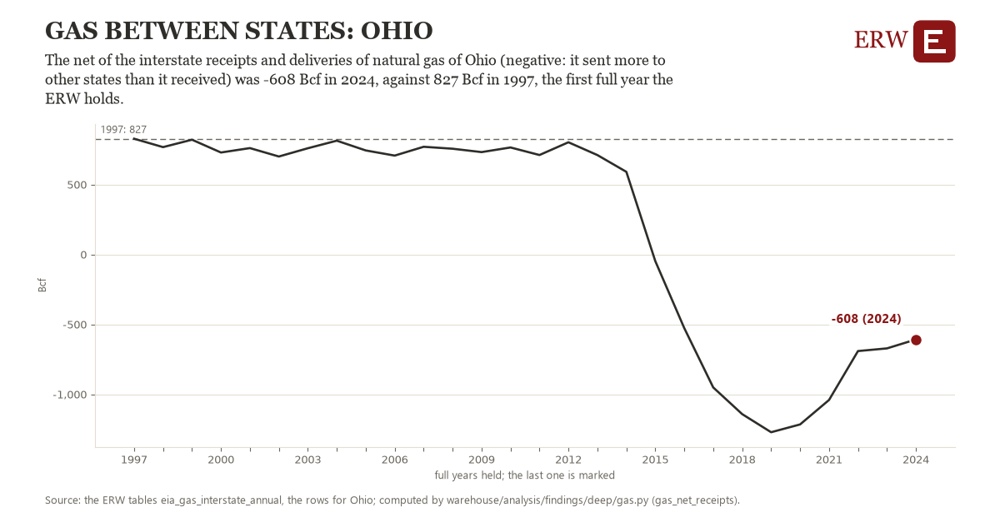

# Gas between states: Ohio

Draft `scan-deep-c45132b23ef7` of the findings hunt over the whole warehouse (chain 502), 2026-11-19. State: draft, not reviewed. Review at `/internal/findings`.

**The finding.** The net of the interstate receipts and deliveries of natural gas of Ohio (negative: it sent more to other states than it received) was -608 Bcf in 2024, against 827 Bcf in 1997, the first full year the ERW holds.

**The figure by full year** (Bcf): 1997: 827, 1998: 767, 1999: 820, 2000: 728, 2001: 760, 2002: 700, 2003: 759, 2004: 813, 2005: 743, 2006: 706, 2007: 769, 2008: 755, 2009: 731, 2010: 764, 2011: 710, 2012: 801, 2013: 710, 2014: 590, 2015: -48, 2016: -527, 2017: -951, 2018: -1,142, 2019: -1,272, 2020: -1,216, 2021: -1,041, 2022: -691, 2023: -672, 2024: -608.

**The tables and rows.** `eia_gas_interstate_annual`; the rows for Ohio, region key `gn_oh` (the card's `hunt.region`), years 1997 to 2024. The yearly values: `gas-net-receipts-gn-oh.csv`.

**Its strength.** The change is 15.36 typical yearly moves (a typical move is 93 Bcf, 1.4826 times the median absolute change between full years). Holds in more than one year: 27 of the 27 full years after 1997 lie below 1997's value. Survives a change of window: from 1998 to 2024 the change is -1,375, from 1997 to 2023 it is -1,499. Sample large enough: 1997 holds 1 and 2024 holds 1 observations; the floor is 1. Half the change remains without the first year: from 1998 to 2024 the change is -1,375, 95.8 percent of the change from 1997. At least one typical yearly move: the change is 15.36 typical yearly moves (93 Bcf a year, the median move between full years); the floor is 1.

**Its limits.** EIA's interstate movements as reported by the pipelines; a state's net receipts include gas passing through it to other states.

**Reproduce.** `python gas-net-receipts-gn-oh.reproduce.py <the table's CSV>` and `do gas-net-receipts-gn-oh.reproduce.do` (Stata) recompute the figures by year from the tables as the public downloads hold them; each names the expected values at its top.
