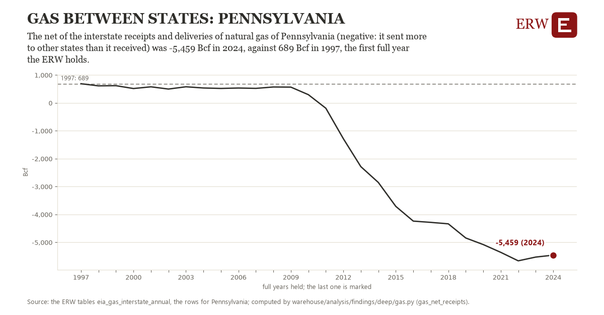

# Gas between states: Pennsylvania

Draft `scan-deep-b4dd2d23a5cc` of the findings hunt over the whole warehouse (chain 502), 2026-11-19. State: draft, not reviewed. Review at `/internal/findings`.

**The finding.** The net of the interstate receipts and deliveries of natural gas of Pennsylvania (negative: it sent more to other states than it received) was -5,459 Bcf in 2024, against 689 Bcf in 1997, the first full year the ERW holds.

**The figure by full year** (Bcf): 1997: 689, 1998: 612, 1999: 618, 2000: 516, 2001: 578, 2002: 498, 2003: 579, 2004: 536, 2005: 520, 2006: 534, 2007: 522, 2008: 572, 2009: 567, 2010: 296, 2011: -190, 2012: -1,282, 2013: -2,284, 2014: -2,852, 2015: -3,710, 2016: -4,238, 2017: -4,284, 2018: -4,336, 2019: -4,844, 2020: -5,080, 2021: -5,358, 2022: -5,663, 2023: -5,528, 2024: -5,459.

**The tables and rows.** `eia_gas_interstate_annual`; the rows for Pennsylvania, region key `gn_pa` (the card's `hunt.region`), years 1997 to 2024. The yearly values: `gas-net-receipts-gn-pa.csv`.

**Its strength.** The change is 50.96 typical yearly moves (a typical move is 121 Bcf, 1.4826 times the median absolute change between full years). Holds in more than one year: 27 of the 27 full years after 1997 lie below 1997's value. Survives a change of window: from 1998 to 2024 the change is -6,072, from 1997 to 2023 it is -6,217. Sample large enough: 1997 holds 1 and 2024 holds 1 observations; the floor is 1. Half the change remains without the first year: from 1998 to 2024 the change is -6,072, 98.8 percent of the change from 1997. At least one typical yearly move: the change is 50.96 typical yearly moves (121 Bcf a year, the median move between full years); the floor is 1.

**Its limits.** EIA's interstate movements as reported by the pipelines; a state's net receipts include gas passing through it to other states.

**Reproduce.** `python gas-net-receipts-gn-pa.reproduce.py <the table's CSV>` and `do gas-net-receipts-gn-pa.reproduce.do` (Stata) recompute the figures by year from the tables as the public downloads hold them; each names the expected values at its top.
