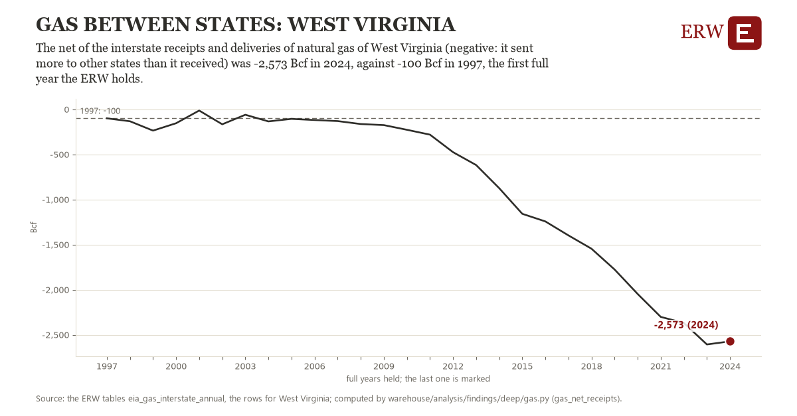

# Gas between states: West Virginia

Draft `scan-deep-1ac5542d4cba` of the findings hunt over the whole warehouse (chain 502), 2026-11-19. State: draft, not reviewed. Review at `/internal/findings`.

**The finding.** The net of the interstate receipts and deliveries of natural gas of West Virginia (negative: it sent more to other states than it received) was -2,573 Bcf in 2024, against -100 Bcf in 1997, the first full year the ERW holds.

**The figure by full year** (Bcf): 1997: -100, 1998: -133, 1999: -237, 2000: -155, 2001: -14, 2002: -166, 2003: -61, 2004: -134, 2005: -106, 2006: -119, 2007: -131, 2008: -164, 2009: -175, 2010: -227, 2011: -281, 2012: -476, 2013: -618, 2014: -875, 2015: -1,159, 2016: -1,244, 2017: -1,398, 2018: -1,546, 2019: -1,777, 2020: -2,048, 2021: -2,302, 2022: -2,369, 2023: -2,608, 2024: -2,573.

**The tables and rows.** `eia_gas_interstate_annual`; the rows for West Virginia, region key `gn_wv` (the card's `hunt.region`), years 1997 to 2024. The yearly values: `gas-net-receipts-gn-wv.csv`.

**Its strength.** The change is 16.09 typical yearly moves (a typical move is 154 Bcf, 1.4826 times the median absolute change between full years). Holds in more than one year: 25 of the 27 full years after 1997 lie below 1997's value. Survives a change of window: from 1998 to 2024 the change is -2,441, from 1997 to 2023 it is -2,507. Sample large enough: 1997 holds 1 and 2024 holds 1 observations; the floor is 1. Half the change remains without the first year: from 1998 to 2024 the change is -2,441, 98.7 percent of the change from 1997. At least one typical yearly move: the change is 16.09 typical yearly moves (154 Bcf a year, the median move between full years); the floor is 1.

**Its limits.** EIA's interstate movements as reported by the pipelines; a state's net receipts include gas passing through it to other states.

**Reproduce.** `python gas-net-receipts-gn-wv.reproduce.py <the table's CSV>` and `do gas-net-receipts-gn-wv.reproduce.do` (Stata) recompute the figures by year from the tables as the public downloads hold them; each names the expected values at its top.
