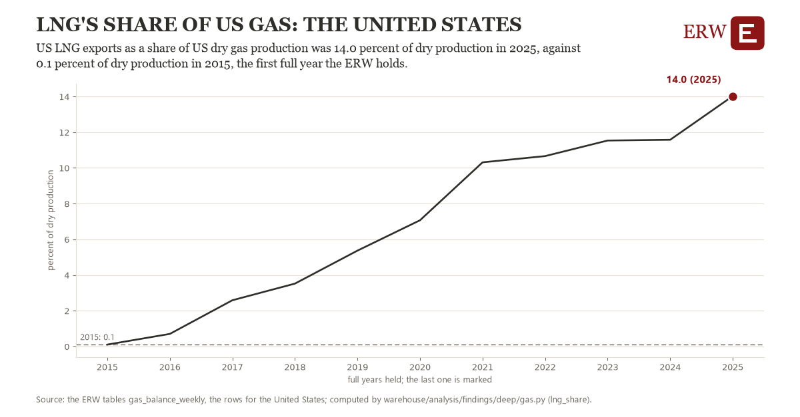

# Lng's share of us gas: the United States

Draft `scan-deep-7c7ba78c393d` of the findings hunt over the whole warehouse (chain 164), 2026-11-06. State: draft, not reviewed. Review at `/internal/findings`.

**The finding.** US LNG exports as a share of US dry gas production was 14.0 percent of dry production in 2025, against 0.1 percent of dry production in 2015, the first full year the ERW holds.

**The figure by full year** (percent of dry production): 2015: 0.1, 2016: 0.7, 2017: 2.6, 2018: 3.5, 2019: 5.4, 2020: 7.1, 2021: 10.3, 2022: 10.7, 2023: 11.5, 2024: 11.6, 2025: 14.0.

**The tables and rows.** `gas_balance_weekly`; the rows for the United States, region key `us_lng` (the card's `hunt.region`), years 2015 to 2025. The yearly values: `lng-share-us-lng.csv`.

**Its strength.** The change is 7.13 typical yearly moves (a typical move is 2.0 percent of dry production, 1.4826 times the median absolute change between full years). Holds in more than one year: 10 of the 10 full years after 2015 lie above 2015's value. Survives a change of window: from 2016 to 2025 the change is 13.3, from 2015 to 2024 it is 11.5. Sample large enough: 2015 holds 12 and 2025 holds 12 observations; the floor is 11. Half the change remains without the first year: from 2016 to 2025 the change is 13.3, 95.7 percent of the change from 2015. At least one typical yearly move: the change is 7.13 typical yearly moves (2.0 percent of dry production a year, the median move between full years); the floor is 1.

**Its limits.** EIA's monthly figures as published, the latest months preliminary and EIA's estimates where a state does not report. LNG exports are measured at the terminals, dry production at the wells' processing; the share is of what is produced, not of what is used.

**Reproduce.** `python lng-share-us-lng.reproduce.py <the table's CSV>` and `do lng-share-us-lng.reproduce.do` (Stata) recompute the figures by year from the tables as the public downloads hold them; each names the expected values at its top.
