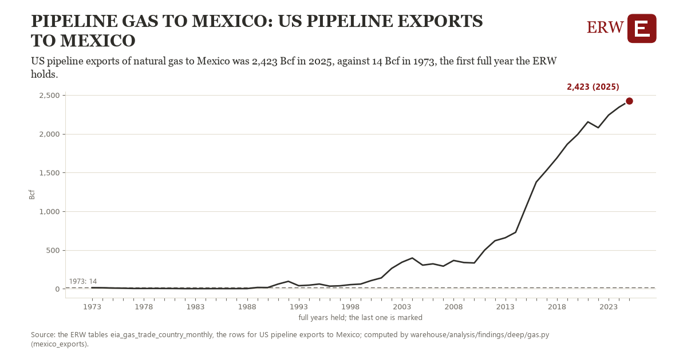

# Pipeline gas to mexico: US pipeline exports to Mexico

Draft `scan-deep-fc2e875ea6e1` of the findings hunt over the whole warehouse (chain 164), 2026-11-06. State: draft, not reviewed. Review at `/internal/findings`.

**The finding.** US pipeline exports of natural gas to Mexico was 2,423 Bcf in 2025, against 14 Bcf in 1973, the first full year the ERW holds.

**The figure by full year** (Bcf): 1973: 14, 1974: 13, 1975: 9, 1976: 7, 1977: 4, 1978: 4, 1979: 4, 1980: 4, 1981: 3, 1982: 2, 1983: 2, 1984: 2, 1985: 2, 1986: 2, 1987: 2, 1988: 2, 1989: 17, 1990: 16, 1991: 60, 1992: 96, 1993: 40, 1994: 46, 1995: 61, 1996: 34, 1997: 38, 1998: 53, 1999: 61, 2000: 105, 2001: 140, 2002: 263, 2003: 343, 2004: 397, 2005: 305, 2006: 322, 2007: 292, 2008: 365, 2009: 338, 2010: 333, 2011: 499, 2012: 620, 2013: 658, 2014: 729, 2015: 1,054, 2016: 1,377, 2017: 1,530, 2018: 1,689, 2019: 1,865, 2020: 1,991, 2021: 2,154, 2022: 2,079, 2023: 2,242, 2024: 2,343, 2025: 2,423.

**The tables and rows.** `eia_gas_trade_country_monthly`; the rows for US pipeline exports to Mexico, region key `us_mexico` (the card's `hunt.region`), years 1973 to 2025. The yearly values: `mexico-exports-us-mexico.csv`.

**Its strength.** The change is 56.39 typical yearly moves (a typical move is 43 Bcf, 1.4826 times the median absolute change between full years). Holds in more than one year: 37 of the 52 full years after 1973 lie above 1973's value. Survives a change of window: from 1974 to 2025 the change is 2,410, from 1973 to 2024 it is 2,329. Sample large enough: 1973 holds 12 and 2025 holds 12 observations; the floor is 11. Half the change remains without the first year: from 1974 to 2025 the change is 2,410, 100.0 percent of the change from 1973. At least one typical yearly move: the change is 56.39 typical yearly moves (43 Bcf a year, the median move between full years); the floor is 1.

**Its limits.** EIA's monthly figures as published, the latest months preliminary and EIA's estimates where a state does not report. Volumes in Bcf (EIA's MMcf over 1,000); the latest months are EIA's estimates.

**Reproduce.** `python mexico-exports-us-mexico.reproduce.py <the table's CSV>` and `do mexico-exports-us-mexico.reproduce.do` (Stata) recompute the figures by year from the tables as the public downloads hold them; each names the expected values at its top.
