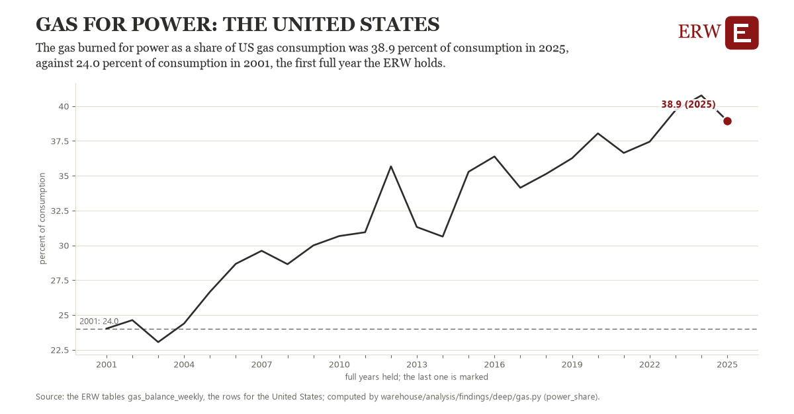

# Gas for power: the United States

Draft `scan-deep-7c1da7c0bbd9` of the findings hunt over the whole warehouse (chain 164), 2026-11-06. State: draft, not reviewed. Review at `/internal/findings`.

**The finding.** The gas burned for power as a share of US gas consumption was 38.9 percent of consumption in 2025, against 24.0 percent of consumption in 2001, the first full year the ERW holds.

**The figure by full year** (percent of consumption): 2001: 24.0, 2002: 24.6, 2003: 23.1, 2004: 24.4, 2005: 26.7, 2006: 28.7, 2007: 29.6, 2008: 28.6, 2009: 30.0, 2010: 30.7, 2011: 30.9, 2012: 35.7, 2013: 31.3, 2014: 30.6, 2015: 35.3, 2016: 36.4, 2017: 34.1, 2018: 35.1, 2019: 36.3, 2020: 38.0, 2021: 36.6, 2022: 37.4, 2023: 39.7, 2024: 40.8, 2025: 38.9.

**The tables and rows.** `gas_balance_weekly`; the rows for the United States, region key `us_power_burn` (the card's `hunt.region`), years 2001 to 2025. The yearly values: `power-share-us-power-burn.csv`.

**Its strength.** The change is 7.49 typical yearly moves (a typical move is 2.0 percent of consumption, 1.4826 times the median absolute change between full years). Holds in more than one year: 23 of the 24 full years after 2001 lie above 2001's value. Survives a change of window: from 2002 to 2025 the change is 14.3, from 2001 to 2024 it is 16.7. Sample large enough: 2001 holds 12 and 2025 holds 12 observations; the floor is 11. Half the change remains without the first year: from 2002 to 2025 the change is 14.3, 95.9 percent of the change from 2001. At least one typical yearly move: the change is 7.49 typical yearly moves (2.0 percent of consumption a year, the median move between full years); the floor is 1.

**Its limits.** EIA's monthly figures as published, the latest months preliminary and EIA's estimates where a state does not report.

**Reproduce.** `python power-share-us-power-burn.reproduce.py <the table's CSV>` and `do power-share-us-power-burn.reproduce.do` (Stata) recompute the figures by year from the tables as the public downloads hold them; each names the expected values at its top.
