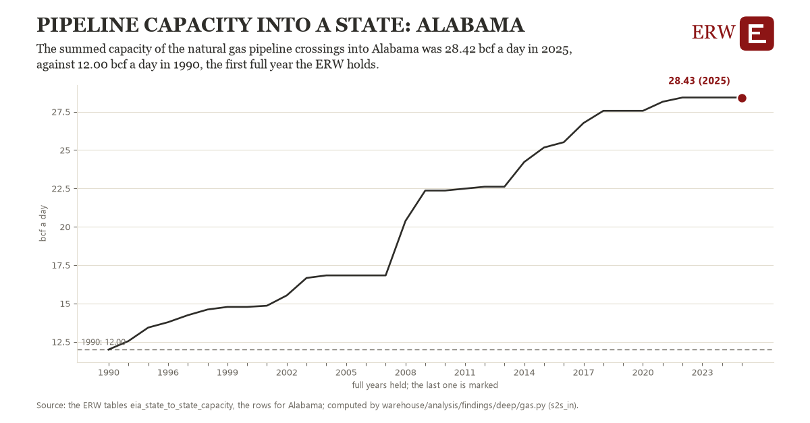

# Pipeline capacity into a state: Alabama

Draft `scan-deep-d4d616fb9b71` of the findings hunt over the whole warehouse (chain 502), 2026-11-19. State: draft, not reviewed. Review at `/internal/findings`.

**The finding.** The summed capacity of the natural gas pipeline crossings into Alabama was 28.42 bcf a day in 2025, against 12.00 bcf a day in 1990, the first full year the ERW holds.

**The figure by full year** (bcf a day): 1990: 12.00, 1994: 12.55, 1995: 13.43, 1996: 13.78, 1997: 14.23, 1998: 14.61, 1999: 14.78, 2000: 14.78, 2001: 14.86, 2002: 15.52, 2003: 16.66, 2004: 16.83, 2005: 16.83, 2006: 16.83, 2007: 16.83, 2008: 20.38, 2009: 22.36, 2010: 22.36, 2011: 22.48, 2012: 22.61, 2013: 22.61, 2014: 24.22, 2015: 25.17, 2016: 25.51, 2017: 26.76, 2018: 27.56, 2019: 27.56, 2020: 27.56, 2021: 28.15, 2022: 28.42, 2023: 28.42, 2024: 28.42, 2025: 28.42.

**The tables and rows.** `eia_state_to_state_capacity`; the rows for Alabama, region key `s2in_alabama` (the card's `hunt.region`), years 1990 to 2025. The yearly values: `s2s-in-s2in-alabama.csv`.

**Its strength.** The change is 49.91 typical yearly moves (a typical move is 0.33 bcf a day, 1.4826 times the median absolute change between full years). Holds in more than one year: 32 of the 32 full years after 1990 lie above 1990's value. Survives a change of window: from 1994 to 2025 the change is 15.87, from 1990 to 2024 it is 16.43. Sample large enough: 1990 holds 1 and 2025 holds 1 observations; the floor is 1. Half the change remains without the first year: from 1994 to 2025 the change is 15.87, 96.6 percent of the change from 1990. At least one typical yearly move: the change is 49.91 typical yearly moves (0.33 bcf a day a year, the median move between full years); the floor is 1.

**Its limits.** EIA's State-to-State Capacity as its January 2026 issue lists it: each pipeline's capacity at a border crossing, a year; capacity is what a pipeline can carry, not what it carried.

**Reproduce.** `python s2s-in-s2in-alabama.reproduce.py <the table's CSV>` and `do s2s-in-s2in-alabama.reproduce.do` (Stata) recompute the figures by year from the tables as the public downloads hold them; each names the expected values at its top.
