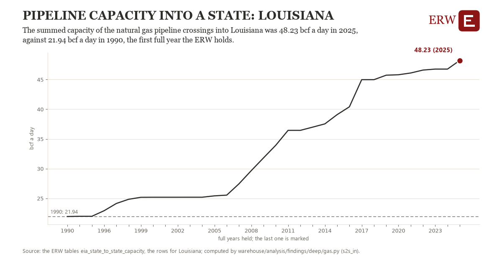

# Pipeline capacity into a state: Louisiana

Draft `scan-deep-6095c41406d2` of the findings hunt over the whole warehouse (chain 502), 2026-11-19. State: draft, not reviewed. Review at `/internal/findings`.

**The finding.** The summed capacity of the natural gas pipeline crossings into Louisiana was 48.23 bcf a day in 2025, against 21.94 bcf a day in 1990, the first full year the ERW holds.

**The figure by full year** (bcf a day): 1990: 21.94, 1994: 21.97, 1995: 21.97, 1996: 22.91, 1997: 24.13, 1998: 24.84, 1999: 25.17, 2000: 25.18, 2001: 25.18, 2002: 25.18, 2003: 25.19, 2004: 25.19, 2005: 25.42, 2006: 25.54, 2007: 27.45, 2008: 29.67, 2009: 31.82, 2010: 33.95, 2011: 36.45, 2012: 36.45, 2013: 36.99, 2014: 37.54, 2015: 39.10, 2016: 40.41, 2017: 44.98, 2018: 44.98, 2019: 45.74, 2020: 45.81, 2021: 46.11, 2022: 46.60, 2023: 46.77, 2024: 46.77, 2025: 48.23.

**The tables and rows.** `eia_state_to_state_capacity`; the rows for Louisiana, region key `s2in_louisiana` (the card's `hunt.region`), years 1990 to 2025. The yearly values: `s2s-in-s2in-louisiana.csv`.

**Its strength.** The change is 42.83 typical yearly moves (a typical move is 0.61 bcf a day, 1.4826 times the median absolute change between full years). Holds in more than one year: 32 of the 32 full years after 1990 lie above 1990's value. Survives a change of window: from 1994 to 2025 the change is 26.26, from 1990 to 2024 it is 24.83. Sample large enough: 1990 holds 1 and 2025 holds 1 observations; the floor is 1. Half the change remains without the first year: from 1994 to 2025 the change is 26.26, 99.9 percent of the change from 1990. At least one typical yearly move: the change is 42.83 typical yearly moves (0.61 bcf a day a year, the median move between full years); the floor is 1.

**Its limits.** EIA's State-to-State Capacity as its January 2026 issue lists it: each pipeline's capacity at a border crossing, a year; capacity is what a pipeline can carry, not what it carried.

**Reproduce.** `python s2s-in-s2in-louisiana.reproduce.py <the table's CSV>` and `do s2s-in-s2in-louisiana.reproduce.do` (Stata) recompute the figures by year from the tables as the public downloads hold them; each names the expected values at its top.
