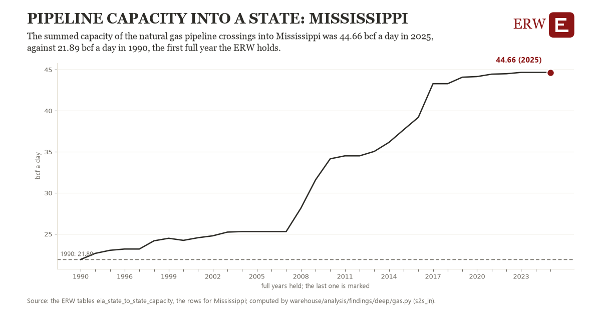

# Pipeline capacity into a state: Mississippi

Draft `scan-deep-cf4d23928672` of the findings hunt over the whole warehouse (chain 502), 2026-11-19. State: draft, not reviewed. Review at `/internal/findings`.

**The finding.** The summed capacity of the natural gas pipeline crossings into Mississippi was 44.66 bcf a day in 2025, against 21.89 bcf a day in 1990, the first full year the ERW holds.

**The figure by full year** (bcf a day): 1990: 21.89, 1994: 22.64, 1995: 23.01, 1996: 23.16, 1997: 23.16, 1998: 24.16, 1999: 24.47, 2000: 24.22, 2001: 24.54, 2002: 24.77, 2003: 25.23, 2004: 25.29, 2005: 25.29, 2006: 25.29, 2007: 25.29, 2008: 28.13, 2009: 31.58, 2010: 34.14, 2011: 34.50, 2012: 34.50, 2013: 35.04, 2014: 36.14, 2015: 37.68, 2016: 39.19, 2017: 43.29, 2018: 43.29, 2019: 44.08, 2020: 44.15, 2021: 44.45, 2022: 44.50, 2023: 44.66, 2024: 44.66, 2025: 44.66.

**The tables and rows.** `eia_state_to_state_capacity`; the rows for Mississippi, region key `s2in_mississippi` (the card's `hunt.region`), years 1990 to 2025. The yearly values: `s2s-in-s2in-mississippi.csv`.

**Its strength.** The change is 50.77 typical yearly moves (a typical move is 0.45 bcf a day, 1.4826 times the median absolute change between full years). Holds in more than one year: 32 of the 32 full years after 1990 lie above 1990's value. Survives a change of window: from 1994 to 2025 the change is 22.03, from 1990 to 2024 it is 22.77. Sample large enough: 1990 holds 1 and 2025 holds 1 observations; the floor is 1. Half the change remains without the first year: from 1994 to 2025 the change is 22.03, 96.7 percent of the change from 1990. At least one typical yearly move: the change is 50.77 typical yearly moves (0.45 bcf a day a year, the median move between full years); the floor is 1.

**Its limits.** EIA's State-to-State Capacity as its January 2026 issue lists it: each pipeline's capacity at a border crossing, a year; capacity is what a pipeline can carry, not what it carried.

**Reproduce.** `python s2s-in-s2in-mississippi.reproduce.py <the table's CSV>` and `do s2s-in-s2in-mississippi.reproduce.do` (Stata) recompute the figures by year from the tables as the public downloads hold them; each names the expected values at its top.
