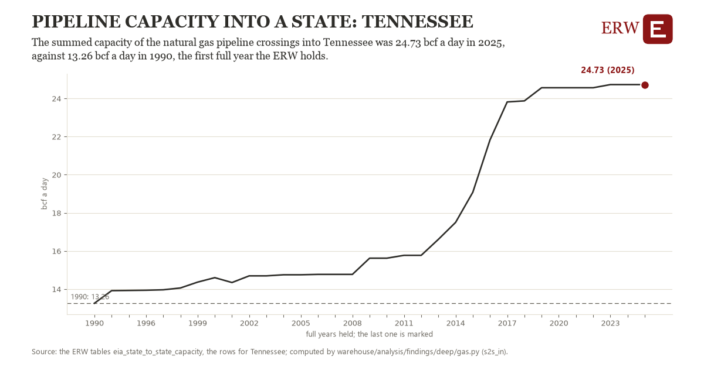

# Pipeline capacity into a state: Tennessee

Draft `scan-deep-7874e9910971` of the findings hunt over the whole warehouse (chain 502), 2026-11-19. State: draft, not reviewed. Review at `/internal/findings`.

**The finding.** The summed capacity of the natural gas pipeline crossings into Tennessee was 24.73 bcf a day in 2025, against 13.26 bcf a day in 1990, the first full year the ERW holds.

**The figure by full year** (bcf a day): 1990: 13.26, 1994: 13.92, 1995: 13.93, 1996: 13.94, 1997: 13.96, 1998: 14.06, 1999: 14.36, 2000: 14.60, 2001: 14.34, 2002: 14.69, 2003: 14.69, 2004: 14.75, 2005: 14.75, 2006: 14.77, 2007: 14.77, 2008: 14.77, 2009: 15.62, 2010: 15.62, 2011: 15.77, 2012: 15.77, 2013: 16.61, 2014: 17.50, 2015: 19.08, 2016: 21.82, 2017: 23.82, 2018: 23.87, 2019: 24.56, 2020: 24.56, 2021: 24.56, 2022: 24.56, 2023: 24.73, 2024: 24.73, 2025: 24.73.

**The tables and rows.** `eia_state_to_state_capacity`; the rows for Tennessee, region key `s2in_tennessee` (the card's `hunt.region`), years 1990 to 2025. The yearly values: `s2s-in-s2in-tennessee.csv`.

**Its strength.** The change is 136.96 typical yearly moves (a typical move is 0.08 bcf a day, 1.4826 times the median absolute change between full years). Holds in more than one year: 32 of the 32 full years after 1990 lie above 1990's value. Survives a change of window: from 1994 to 2025 the change is 10.81, from 1990 to 2024 it is 11.47. Sample large enough: 1990 holds 1 and 2025 holds 1 observations; the floor is 1. Half the change remains without the first year: from 1994 to 2025 the change is 10.81, 94.2 percent of the change from 1990. At least one typical yearly move: the change is 136.96 typical yearly moves (0.08 bcf a day a year, the median move between full years); the floor is 1.

**Its limits.** EIA's State-to-State Capacity as its January 2026 issue lists it: each pipeline's capacity at a border crossing, a year; capacity is what a pipeline can carry, not what it carried.

**Reproduce.** `python s2s-in-s2in-tennessee.reproduce.py <the table's CSV>` and `do s2s-in-s2in-tennessee.reproduce.do` (Stata) recompute the figures by year from the tables as the public downloads hold them; each names the expected values at its top.
