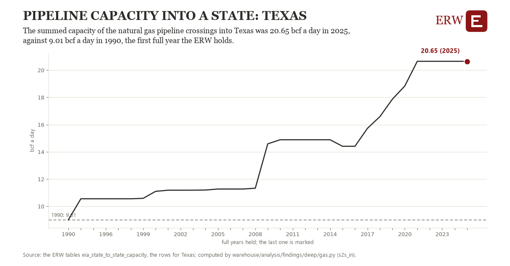

# Pipeline capacity into a state: Texas

Draft `scan-deep-1ad75828d8b3` of the findings hunt over the whole warehouse (chain 502), 2026-11-19. State: draft, not reviewed. Review at `/internal/findings`.

**The finding.** The summed capacity of the natural gas pipeline crossings into Texas was 20.65 bcf a day in 2025, against 9.01 bcf a day in 1990, the first full year the ERW holds.

**The figure by full year** (bcf a day): 1990: 9.01, 1994: 10.55, 1995: 10.55, 1996: 10.55, 1997: 10.55, 1998: 10.55, 1999: 10.58, 2000: 11.10, 2001: 11.18, 2002: 11.18, 2003: 11.19, 2004: 11.20, 2005: 11.27, 2006: 11.27, 2007: 11.27, 2008: 11.33, 2009: 14.59, 2010: 14.89, 2011: 14.89, 2012: 14.89, 2013: 14.89, 2014: 14.89, 2015: 14.41, 2016: 14.41, 2017: 15.72, 2018: 16.58, 2019: 17.86, 2020: 18.84, 2021: 20.65, 2022: 20.65, 2023: 20.65, 2024: 20.65, 2025: 20.65.

**The tables and rows.** `eia_state_to_state_capacity`; the rows for Texas, region key `s2in_texas` (the card's `hunt.region`), years 1990 to 2025. The yearly values: `s2s-in-s2in-texas.csv`.

**Its strength.** The change is 5,233.15 typical yearly moves (a typical move is 0.00 bcf a day, 1.4826 times the median absolute change between full years). Holds in more than one year: 32 of the 32 full years after 1990 lie above 1990's value. Survives a change of window: from 1994 to 2025 the change is 10.09, from 1990 to 2024 it is 11.64. Sample large enough: 1990 holds 1 and 2025 holds 1 observations; the floor is 1. Half the change remains without the first year: from 1994 to 2025 the change is 10.09, 86.7 percent of the change from 1990. At least one typical yearly move: the change is 5,233.15 typical yearly moves (0.00 bcf a day a year, the median move between full years); the floor is 1.

**Its limits.** EIA's State-to-State Capacity as its January 2026 issue lists it: each pipeline's capacity at a border crossing, a year; capacity is what a pipeline can carry, not what it carried.

**Reproduce.** `python s2s-in-s2in-texas.reproduce.py <the table's CSV>` and `do s2s-in-s2in-texas.reproduce.do` (Stata) recompute the figures by year from the tables as the public downloads hold them; each names the expected values at its top.
