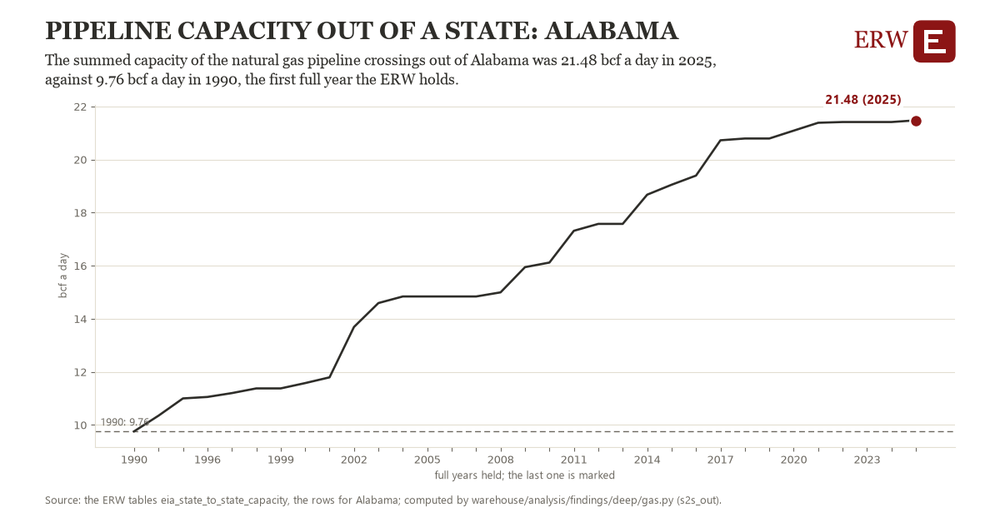

# Pipeline capacity out of a state: Alabama

Draft `scan-deep-1301f727f25e` of the findings hunt over the whole warehouse (chain 502), 2026-11-19. State: draft, not reviewed. Review at `/internal/findings`.

**The finding.** The summed capacity of the natural gas pipeline crossings out of Alabama was 21.48 bcf a day in 2025, against 9.76 bcf a day in 1990, the first full year the ERW holds.

**The figure by full year** (bcf a day): 1990: 9.76, 1994: 10.35, 1995: 11.00, 1996: 11.05, 1997: 11.20, 1998: 11.37, 1999: 11.37, 2000: 11.57, 2001: 11.79, 2002: 13.69, 2003: 14.59, 2004: 14.84, 2005: 14.84, 2006: 14.84, 2007: 14.84, 2008: 14.99, 2009: 15.94, 2010: 16.12, 2011: 17.31, 2012: 17.57, 2013: 17.57, 2014: 18.67, 2015: 19.05, 2016: 19.39, 2017: 20.72, 2018: 20.79, 2019: 20.79, 2020: 21.09, 2021: 21.38, 2022: 21.41, 2023: 21.41, 2024: 21.41, 2025: 21.48.

**The tables and rows.** `eia_state_to_state_capacity`; the rows for Alabama, region key `s2out_alabama` (the card's `hunt.region`), years 1990 to 2025. The yearly values: `s2s-out-s2out-alabama.csv`.

**Its strength.** The change is 41.93 typical yearly moves (a typical move is 0.28 bcf a day, 1.4826 times the median absolute change between full years). Holds in more than one year: 32 of the 32 full years after 1990 lie above 1990's value. Survives a change of window: from 1994 to 2025 the change is 11.13, from 1990 to 2024 it is 11.66. Sample large enough: 1990 holds 1 and 2025 holds 1 observations; the floor is 1. Half the change remains without the first year: from 1994 to 2025 the change is 11.13, 95.0 percent of the change from 1990. At least one typical yearly move: the change is 41.93 typical yearly moves (0.28 bcf a day a year, the median move between full years); the floor is 1.

**Its limits.** EIA's State-to-State Capacity as its January 2026 issue lists it: each pipeline's capacity at a border crossing, a year; capacity is what a pipeline can carry, not what it carried.

**Reproduce.** `python s2s-out-s2out-alabama.reproduce.py <the table's CSV>` and `do s2s-out-s2out-alabama.reproduce.do` (Stata) recompute the figures by year from the tables as the public downloads hold them; each names the expected values at its top.
