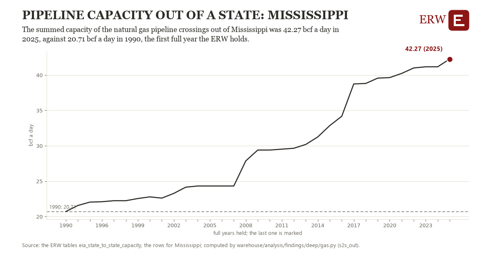

# Pipeline capacity out of a state: Mississippi

Draft `scan-deep-145ad1bd3d51` of the findings hunt over the whole warehouse (chain 502), 2026-11-19. State: draft, not reviewed. Review at `/internal/findings`.

**The finding.** The summed capacity of the natural gas pipeline crossings out of Mississippi was 42.27 bcf a day in 2025, against 20.71 bcf a day in 1990, the first full year the ERW holds.

**The figure by full year** (bcf a day): 1990: 20.71, 1994: 21.56, 1995: 22.04, 1996: 22.10, 1997: 22.24, 1998: 22.24, 1999: 22.55, 2000: 22.78, 2001: 22.61, 2002: 23.28, 2003: 24.15, 2004: 24.32, 2005: 24.32, 2006: 24.32, 2007: 24.32, 2008: 27.87, 2009: 29.40, 2010: 29.40, 2011: 29.53, 2012: 29.65, 2013: 30.19, 2014: 31.25, 2015: 32.86, 2016: 34.17, 2017: 38.74, 2018: 38.81, 2019: 39.57, 2020: 39.64, 2021: 40.23, 2022: 41.00, 2023: 41.17, 2024: 41.17, 2025: 42.27.

**The tables and rows.** `eia_state_to_state_capacity`; the rows for Mississippi, region key `s2out_mississippi` (the card's `hunt.region`), years 1990 to 2025. The yearly values: `s2s-out-s2out-mississippi.csv`.

**Its strength.** The change is 53.65 typical yearly moves (a typical move is 0.40 bcf a day, 1.4826 times the median absolute change between full years). Holds in more than one year: 32 of the 32 full years after 1990 lie above 1990's value. Survives a change of window: from 1994 to 2025 the change is 20.70, from 1990 to 2024 it is 20.46. Sample large enough: 1990 holds 1 and 2025 holds 1 observations; the floor is 1. Half the change remains without the first year: from 1994 to 2025 the change is 20.70, 96.0 percent of the change from 1990. At least one typical yearly move: the change is 53.65 typical yearly moves (0.40 bcf a day a year, the median move between full years); the floor is 1.

**Its limits.** EIA's State-to-State Capacity as its January 2026 issue lists it: each pipeline's capacity at a border crossing, a year; capacity is what a pipeline can carry, not what it carried.

**Reproduce.** `python s2s-out-s2out-mississippi.reproduce.py <the table's CSV>` and `do s2s-out-s2out-mississippi.reproduce.do` (Stata) recompute the figures by year from the tables as the public downloads hold them; each names the expected values at its top.
