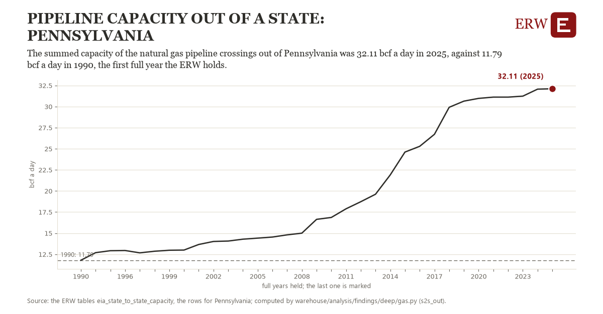

# Pipeline capacity out of a state: Pennsylvania

Draft `scan-deep-929da82b2a16` of the findings hunt over the whole warehouse (chain 502), 2026-11-19. State: draft, not reviewed. Review at `/internal/findings`.

**The finding.** The summed capacity of the natural gas pipeline crossings out of Pennsylvania was 32.11 bcf a day in 2025, against 11.79 bcf a day in 1990, the first full year the ERW holds.

**The figure by full year** (bcf a day): 1990: 11.79, 1994: 12.69, 1995: 12.92, 1996: 12.95, 1997: 12.67, 1998: 12.86, 1999: 12.97, 2000: 13.00, 2001: 13.66, 2002: 14.02, 2003: 14.07, 2004: 14.29, 2005: 14.41, 2006: 14.54, 2007: 14.80, 2008: 15.00, 2009: 16.64, 2010: 16.86, 2011: 17.88, 2012: 18.73, 2013: 19.61, 2014: 21.90, 2015: 24.61, 2016: 25.29, 2017: 26.71, 2018: 29.91, 2019: 30.64, 2020: 30.97, 2021: 31.12, 2022: 31.12, 2023: 31.23, 2024: 32.06, 2025: 32.11.

**The tables and rows.** `eia_state_to_state_capacity`; the rows for Pennsylvania, region key `s2out_pennsylvania` (the card's `hunt.region`), years 1990 to 2025. The yearly values: `s2s-out-s2out-pennsylvania.csv`.

**Its strength.** The change is 50.84 typical yearly moves (a typical move is 0.40 bcf a day, 1.4826 times the median absolute change between full years). Holds in more than one year: 32 of the 32 full years after 1990 lie above 1990's value. Survives a change of window: from 1994 to 2025 the change is 19.42, from 1990 to 2024 it is 20.27. Sample large enough: 1990 holds 1 and 2025 holds 1 observations; the floor is 1. Half the change remains without the first year: from 1994 to 2025 the change is 19.42, 95.6 percent of the change from 1990. At least one typical yearly move: the change is 50.84 typical yearly moves (0.40 bcf a day a year, the median move between full years); the floor is 1.

**Its limits.** EIA's State-to-State Capacity as its January 2026 issue lists it: each pipeline's capacity at a border crossing, a year; capacity is what a pipeline can carry, not what it carried.

**Reproduce.** `python s2s-out-s2out-pennsylvania.reproduce.py <the table's CSV>` and `do s2s-out-s2out-pennsylvania.reproduce.do` (Stata) recompute the figures by year from the tables as the public downloads hold them; each names the expected values at its top.
