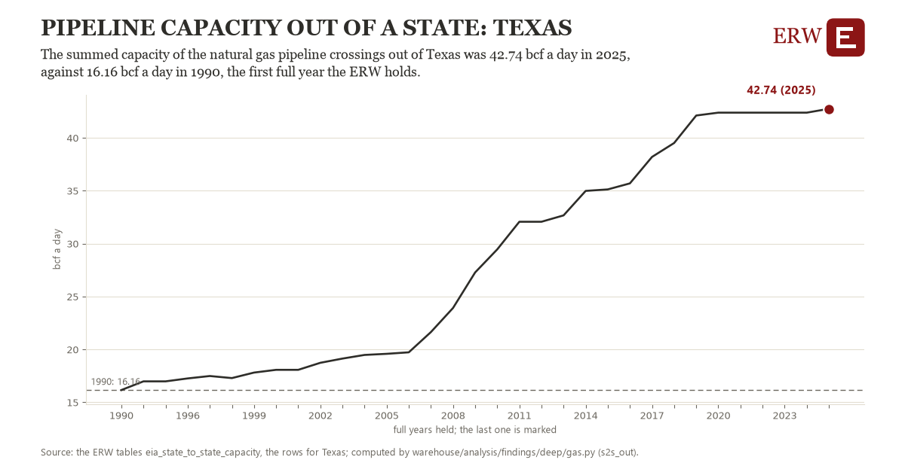

# Pipeline capacity out of a state: Texas

Draft `scan-deep-4d557ca1c6bb` of the findings hunt over the whole warehouse (chain 502), 2026-11-19. State: draft, not reviewed. Review at `/internal/findings`.

**The finding.** The summed capacity of the natural gas pipeline crossings out of Texas was 42.74 bcf a day in 2025, against 16.16 bcf a day in 1990, the first full year the ERW holds.

**The figure by full year** (bcf a day): 1990: 16.16, 1994: 16.98, 1995: 16.98, 1996: 17.26, 1997: 17.49, 1998: 17.29, 1999: 17.81, 2000: 18.07, 2001: 18.07, 2002: 18.74, 2003: 19.14, 2004: 19.48, 2005: 19.59, 2006: 19.73, 2007: 21.64, 2008: 23.92, 2009: 27.28, 2010: 29.46, 2011: 32.07, 2012: 32.07, 2013: 32.67, 2014: 34.99, 2015: 35.13, 2016: 35.70, 2017: 38.20, 2018: 39.51, 2019: 42.11, 2020: 42.38, 2021: 42.38, 2022: 42.38, 2023: 42.38, 2024: 42.38, 2025: 42.74.

**The tables and rows.** `eia_state_to_state_capacity`; the rows for Texas, region key `s2out_texas` (the card's `hunt.region`), years 1990 to 2025. The yearly values: `s2s-out-s2out-texas.csv`.

**Its strength.** The change is 50.57 typical yearly moves (a typical move is 0.53 bcf a day, 1.4826 times the median absolute change between full years). Holds in more than one year: 32 of the 32 full years after 1990 lie above 1990's value. Survives a change of window: from 1994 to 2025 the change is 25.76, from 1990 to 2024 it is 26.22. Sample large enough: 1990 holds 1 and 2025 holds 1 observations; the floor is 1. Half the change remains without the first year: from 1994 to 2025 the change is 25.76, 96.9 percent of the change from 1990. At least one typical yearly move: the change is 50.57 typical yearly moves (0.53 bcf a day a year, the median move between full years); the floor is 1.

**Its limits.** EIA's State-to-State Capacity as its January 2026 issue lists it: each pipeline's capacity at a border crossing, a year; capacity is what a pipeline can carry, not what it carried.

**Reproduce.** `python s2s-out-s2out-texas.reproduce.py <the table's CSV>` and `do s2s-out-s2out-texas.reproduce.do` (Stata) recompute the figures by year from the tables as the public downloads hold them; each names the expected values at its top.
