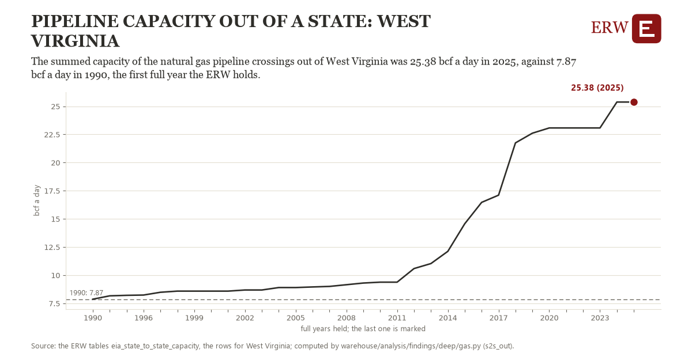

# Pipeline capacity out of a state: West Virginia

Draft `scan-deep-6bddc873871e` of the findings hunt over the whole warehouse (chain 502), 2026-11-19. State: draft, not reviewed. Review at `/internal/findings`.

**The finding.** The summed capacity of the natural gas pipeline crossings out of West Virginia was 25.38 bcf a day in 2025, against 7.87 bcf a day in 1990, the first full year the ERW holds.

**The figure by full year** (bcf a day): 1990: 7.87, 1994: 8.17, 1995: 8.21, 1996: 8.24, 1997: 8.48, 1998: 8.59, 1999: 8.59, 2000: 8.59, 2001: 8.59, 2002: 8.69, 2003: 8.69, 2004: 8.90, 2005: 8.90, 2006: 8.96, 2007: 9.00, 2008: 9.15, 2009: 9.30, 2010: 9.38, 2011: 9.38, 2012: 10.59, 2013: 11.03, 2014: 12.12, 2015: 14.57, 2016: 16.47, 2017: 17.11, 2018: 21.75, 2019: 22.61, 2020: 23.08, 2021: 23.08, 2022: 23.08, 2023: 23.08, 2024: 25.38, 2025: 25.38.

**The tables and rows.** `eia_state_to_state_capacity`; the rows for West Virginia, region key `s2out_west_virginia` (the card's `hunt.region`), years 1990 to 2025. The yearly values: `s2s-out-s2out-west-virginia.csv`.

**Its strength.** The change is 116.92 typical yearly moves (a typical move is 0.15 bcf a day, 1.4826 times the median absolute change between full years). Holds in more than one year: 32 of the 32 full years after 1990 lie above 1990's value. Survives a change of window: from 1994 to 2025 the change is 17.21, from 1990 to 2024 it is 17.51. Sample large enough: 1990 holds 1 and 2025 holds 1 observations; the floor is 1. Half the change remains without the first year: from 1994 to 2025 the change is 17.21, 98.3 percent of the change from 1990. At least one typical yearly move: the change is 116.92 typical yearly moves (0.15 bcf a day a year, the median move between full years); the floor is 1.

**Its limits.** EIA's State-to-State Capacity as its January 2026 issue lists it: each pipeline's capacity at a border crossing, a year; capacity is what a pipeline can carry, not what it carried.

**Reproduce.** `python s2s-out-s2out-west-virginia.reproduce.py <the table's CSV>` and `do s2s-out-s2out-west-virginia.reproduce.do` (Stata) recompute the figures by year from the tables as the public downloads hold them; each names the expected values at its top.
