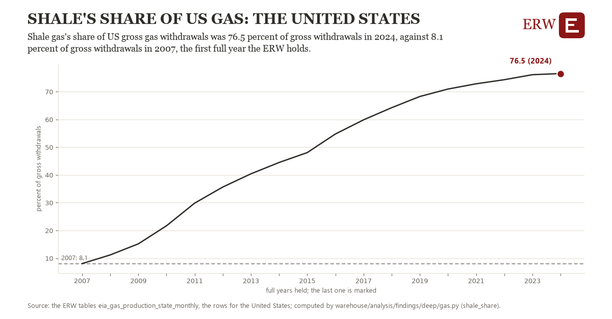

# Shale's share of us gas: the United States

Draft `scan-deep-d6e14ebad25b` of the findings hunt over the whole warehouse (chain 164), 2026-11-06. State: draft, not reviewed. Review at `/internal/findings`.

**The finding.** Shale gas's share of US gross gas withdrawals was 76.5 percent of gross withdrawals in 2024, against 8.1 percent of gross withdrawals in 2007, the first full year the ERW holds.

**The figure by full year** (percent of gross withdrawals): 2007: 8.1, 2008: 11.2, 2009: 15.2, 2010: 21.7, 2011: 29.8, 2012: 35.7, 2013: 40.4, 2014: 44.5, 2015: 48.1, 2016: 54.8, 2017: 59.9, 2018: 64.2, 2019: 68.3, 2020: 71.0, 2021: 72.8, 2022: 74.3, 2023: 76.1, 2024: 76.5.

**The tables and rows.** `eia_gas_production_state_monthly`; the rows for the United States, region key `us_shale` (the card's `hunt.region`), years 2007 to 2024. The yearly values: `shale-share-us-shale.csv`.

**Its strength.** The change is 11.45 typical yearly moves (a typical move is 6.0 percent of gross withdrawals, 1.4826 times the median absolute change between full years). Holds in more than one year: 17 of the 17 full years after 2007 lie above 2007's value. Survives a change of window: from 2008 to 2024 the change is 65.4, from 2007 to 2023 it is 68.1. Sample large enough: 2007 holds 12 and 2024 holds 12 observations; the floor is 11. Half the change remains without the first year: from 2008 to 2024 the change is 65.4, 95.4 percent of the change from 2007. At least one typical yearly move: the change is 11.45 typical yearly moves (6.0 percent of gross withdrawals a year, the median move between full years); the floor is 1.

**Its limits.** EIA's monthly figures as published, the latest months preliminary and EIA's estimates where a state does not report. EIA's shale series ends in 2024.

**Reproduce.** `python shale-share-us-shale.reproduce.py <the table's CSV>` and `do shale-share-us-shale.reproduce.do` (Stata) recompute the figures by year from the tables as the public downloads hold them; each names the expected values at its top.
