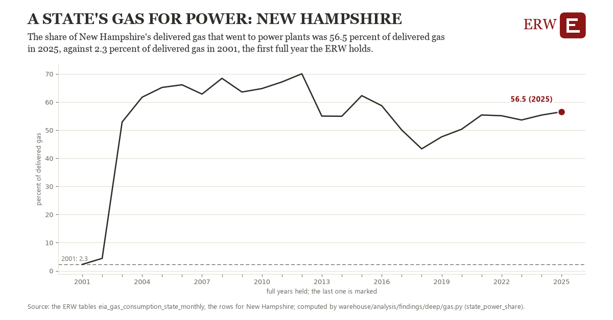

# A state's gas for power: New Hampshire

Draft `scan-deep-998f86c36de8` of the findings hunt over the whole warehouse (chain 164), 2026-11-06. State: draft, not reviewed. Review at `/internal/findings`.

**The finding.** The share of New Hampshire's delivered gas that went to power plants was 56.5 percent of delivered gas in 2025, against 2.3 percent of delivered gas in 2001, the first full year the ERW holds.

**The figure by full year** (percent of delivered gas): 2001: 2.3, 2002: 4.4, 2003: 52.9, 2004: 61.7, 2005: 65.2, 2006: 66.1, 2007: 62.8, 2008: 68.4, 2009: 63.6, 2010: 64.8, 2011: 67.1, 2012: 70.0, 2013: 55.0, 2014: 54.9, 2015: 62.3, 2016: 58.7, 2017: 50.1, 2018: 43.3, 2019: 47.6, 2020: 50.3, 2021: 55.4, 2022: 55.1, 2023: 53.6, 2024: 55.4, 2025: 56.5.

**The tables and rows.** `eia_gas_consumption_state_monthly`; the rows for New Hampshire, region key `burn_NH` (the card's `hunt.region`), years 2001 to 2025. The yearly values: `state-power-share-burn-nh.csv`.

**Its strength.** The change is 10.79 typical yearly moves (a typical move is 5.0 percent of delivered gas, 1.4826 times the median absolute change between full years). Holds in more than one year: 24 of the 24 full years after 2001 lie above 2001's value. Survives a change of window: from 2002 to 2025 the change is 52.1, from 2001 to 2024 it is 53.1. Sample large enough: 2001 holds 12 and 2025 holds 12 observations; the floor is 11. Half the change remains without the first year: from 2002 to 2025 the change is 52.1, 96.0 percent of the change from 2001. At least one typical yearly move: the change is 10.79 typical yearly moves (5.0 percent of delivered gas a year, the median move between full years); the floor is 1.

**Its limits.** EIA's monthly figures as published, the latest months preliminary and EIA's estimates where a state does not report. Deliveries to the four sectors, not counting the gas pipelines and fields use themselves.

**Reproduce.** `python state-power-share-burn-nh.reproduce.py <the table's CSV>` and `do state-power-share-burn-nh.reproduce.do` (Stata) recompute the figures by year from the tables as the public downloads hold them; each names the expected values at its top.
