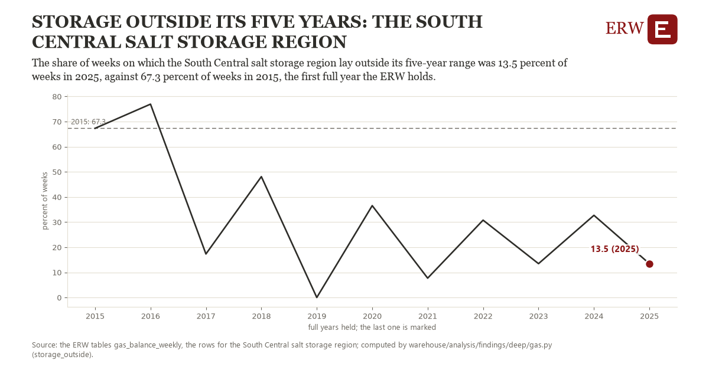

# Storage outside its five years: the South Central salt storage region

Draft `scan-deep-d319970c5c19` of the findings hunt over the whole warehouse (chain 164), 2026-11-06. State: draft, not reviewed. Review at `/internal/findings`.

**The finding.** The share of weeks on which the South Central salt storage region lay outside its five-year range was 13.5 percent of weeks in 2025, against 67.3 percent of weeks in 2015, the first full year the ERW holds.

**The figure by full year** (percent of weeks): 2015: 67.3, 2016: 76.9, 2017: 17.3, 2018: 48.1, 2019: 0.0, 2020: 36.5, 2021: 7.7, 2022: 30.8, 2023: 13.5, 2024: 32.7, 2025: 13.5.

**The tables and rows.** `gas_balance_weekly`; the rows for the South Central salt storage region, region key `stor_salt` (the card's `hunt.region`), years 2015 to 2025. The yearly values: `storage-outside-stor-salt.csv`.

**Its strength.** The change is 1.40 typical yearly moves (a typical move is 38.5 percent of weeks, 1.4826 times the median absolute change between full years). Holds in more than one year: 9 of the 10 full years after 2015 lie below 2015's value. Survives a change of window: from 2016 to 2025 the change is -63.5, from 2015 to 2024 it is -34.6. Sample large enough: 2015 holds 52 and 2025 holds 52 observations; the floor is 45. Half the change remains without the first year: from 2016 to 2025 the change is -63.5, 117.9 percent of the change from 2015. At least one typical yearly move: the change is 1.40 typical yearly moves (38.5 percent of weeks a year, the median move between full years); the floor is 1.

**Its limits.** EIA's weekly working gas against the ERW's five-year range of the same week (gas_balance_weekly); a week outside is outside by any margin.

**Reproduce.** `python storage-outside-stor-salt.reproduce.py <the table's CSV>` and `do storage-outside-stor-salt.reproduce.do` (Stata) recompute the figures by year from the tables as the public downloads hold them; each names the expected values at its top.
