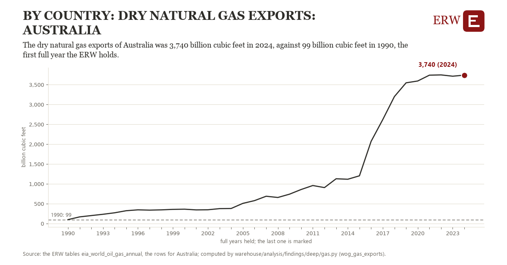

# By country: dry natural gas exports: Australia

Draft `scan-deep-f7a932c0685c` of the findings hunt over the whole warehouse (chain 502), 2026-11-19. State: draft, not reviewed. Review at `/internal/findings`.

**The finding.** The dry natural gas exports of Australia were 3,740 billion cubic feet in 2024, against 99 billion cubic feet in 1990, the first full year the ERW holds.

**The figure by full year** (billion cubic feet): 1990: 99, 1991: 168, 1992: 201, 1993: 234, 1994: 271, 1995: 324, 1996: 345, 1997: 338, 1998: 345, 1999: 357, 2000: 362, 2001: 344, 2002: 347, 2003: 376, 2004: 380, 2005: 509, 2006: 578, 2007: 688, 2008: 657, 2009: 740, 2010: 858, 2011: 958, 2012: 906, 2013: 1,129, 2014: 1,116, 2015: 1,203, 2016: 2,071, 2017: 2,620, 2018: 3,200, 2019: 3,546, 2020: 3,592, 2021: 3,739, 2022: 3,746, 2023: 3,713, 2024: 3,740.

**The tables and rows.** `eia_world_oil_gas_annual`; the rows for Australia, region key `wog_aus` (the card's `hunt.region`), years 1990 to 2024. The yearly values: `wog-gas-exports-wog-aus.csv`.

**Its strength.** The change is 58.70 typical yearly moves (a typical move is 62 billion cubic feet, 1.4826 times the median absolute change between full years). Holds in more than one year: 34 of the 34 full years after 1990 lie above 1990's value. Survives a change of window: from 1991 to 2024 the change is 3,572, from 1990 to 2023 it is 3,615. Sample large enough: 1990 holds 1 and 2024 holds 1 observations; the floor is 1. Half the change remains without the first year: from 1991 to 2024 the change is 3,572, 98.1 percent of the change from 1990. At least one typical yearly move: the change is 58.70 typical yearly moves (62 billion cubic feet a year, the median move between full years); the floor is 1.

**Its limits.** EIA's international energy data as the latest bulk file holds them; a country's recent years are often EIA's estimates; from 1980, when the series begin for every country.

**Reproduce.** `python wog-gas-exports-wog-aus.reproduce.py <the table's CSV>` and `do wog-gas-exports-wog-aus.reproduce.do` (Stata) recompute the figures by year from the tables as the public downloads hold them; each names the expected values at its top.
