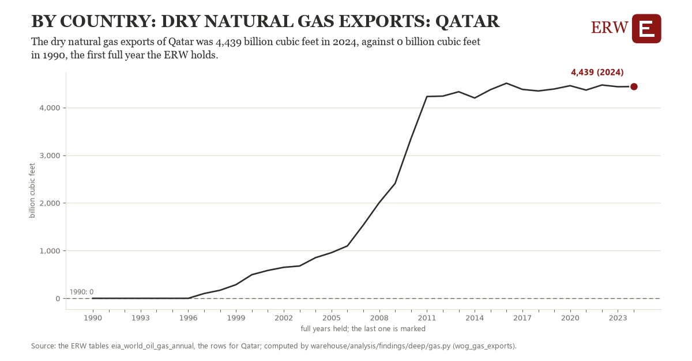

# By country: dry natural gas exports: Qatar

Draft `scan-deep-9288fafd220e` of the findings hunt over the whole warehouse (chain 502), 2026-11-19. State: draft, not reviewed. Review at `/internal/findings`.

**The finding.** The dry natural gas exports of Qatar were 4,439 billion cubic feet in 2024, against 0 billion cubic feet in 1990, the first full year the ERW holds.

**The figure by full year** (billion cubic feet): 1990: 0, 1991: 0, 1992: 0, 1993: 0, 1994: 0, 1995: 0, 1996: 0, 1997: 101, 1998: 169, 1999: 286, 2000: 496, 2001: 584, 2002: 649, 2003: 678, 2004: 853, 2005: 957, 2006: 1,098, 2007: 1,536, 2008: 2,005, 2009: 2,408, 2010: 3,351, 2011: 4,230, 2012: 4,239, 2013: 4,331, 2014: 4,200, 2015: 4,375, 2016: 4,509, 2017: 4,380, 2018: 4,347, 2019: 4,388, 2020: 4,457, 2021: 4,366, 2022: 4,472, 2023: 4,435, 2024: 4,439.

**The tables and rows.** `eia_world_oil_gas_annual`; the rows for Qatar, region key `wog_qat` (the card's `hunt.region`), years 1990 to 2024. The yearly values: `wog-gas-exports-wog-qat.csv`.

**Its strength.** The change is 32.64 typical yearly moves (a typical move is 136 billion cubic feet, 1.4826 times the median absolute change between full years). Holds in more than one year: 28 of the 34 full years after 1990 lie above 1990's value. Survives a change of window: from 1991 to 2024 the change is 4,439, from 1990 to 2023 it is 4,435. Sample large enough: 1990 holds 1 and 2024 holds 1 observations; the floor is 1. Half the change remains without the first year: from 1991 to 2024 the change is 4,439, 100.0 percent of the change from 1990. At least one typical yearly move: the change is 32.64 typical yearly moves (136 billion cubic feet a year, the median move between full years); the floor is 1.

**Its limits.** EIA's international energy data as the latest bulk file holds them; a country's recent years are often EIA's estimates; from 1980, when the series begin for every country.

**Reproduce.** `python wog-gas-exports-wog-qat.reproduce.py <the table's CSV>` and `do wog-gas-exports-wog-qat.reproduce.do` (Stata) recompute the figures by year from the tables as the public downloads hold them; each names the expected values at its top.
