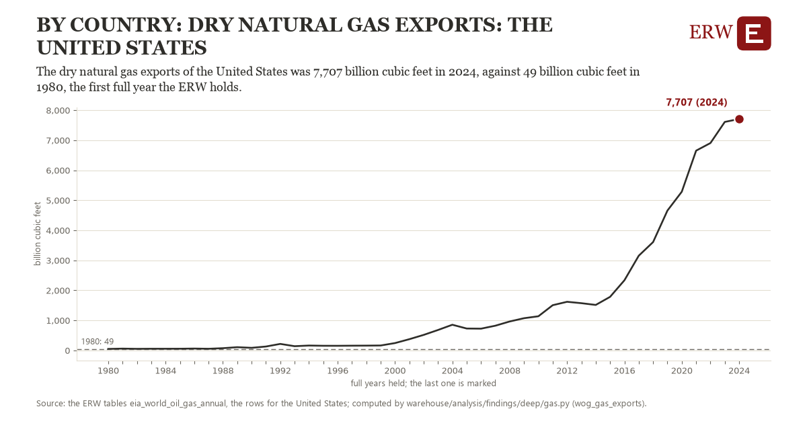

# By country: dry natural gas exports: the United States

Draft `scan-deep-b300df04e3ec` of the findings hunt over the whole warehouse (chain 502), 2026-11-19. State: draft, not reviewed. Review at `/internal/findings`.

**The finding.** The dry natural gas exports of the United States were 7,707 billion cubic feet in 2024, against 49 billion cubic feet in 1980, the first full year the ERW holds.

**The figure by full year** (billion cubic feet): 1980: 49, 1981: 59, 1982: 52, 1983: 55, 1984: 55, 1985: 55, 1986: 61, 1987: 54, 1988: 74, 1989: 107, 1990: 86, 1991: 129, 1992: 216, 1993: 140, 1994: 162, 1995: 154, 1996: 153, 1997: 157, 1998: 159, 1999: 163, 2000: 244, 2001: 373, 2002: 516, 2003: 680, 2004: 854, 2005: 729, 2006: 724, 2007: 822, 2008: 963, 2009: 1,072, 2010: 1,137, 2011: 1,506, 2012: 1,619, 2013: 1,572, 2014: 1,514, 2015: 1,784, 2016: 2,335, 2017: 3,154, 2018: 3,608, 2019: 4,658, 2020: 5,285, 2021: 6,653, 2022: 6,906, 2023: 7,610, 2024: 7,707.

**The tables and rows.** `eia_world_oil_gas_annual`; the rows for the United States, region key `wog_usa` (the card's `hunt.region`), years 1980 to 2024. The yearly values: `wog-gas-exports-wog-usa.csv`.

**Its strength.** The change is 66.05 typical yearly moves (a typical move is 116 billion cubic feet, 1.4826 times the median absolute change between full years). Holds in more than one year: 44 of the 44 full years after 1980 lie above 1980's value. Survives a change of window: from 1981 to 2024 the change is 7,648, from 1980 to 2023 it is 7,561. Sample large enough: 1980 holds 1 and 2024 holds 1 observations; the floor is 1. Half the change remains without the first year: from 1981 to 2024 the change is 7,648, 99.9 percent of the change from 1980. At least one typical yearly move: the change is 66.05 typical yearly moves (116 billion cubic feet a year, the median move between full years); the floor is 1.

**Its limits.** EIA's international energy data as the latest bulk file holds them; a country's recent years are often EIA's estimates; from 1980, when the series begin for every country.

**Reproduce.** `python wog-gas-exports-wog-usa.reproduce.py <the table's CSV>` and `do wog-gas-exports-wog-usa.reproduce.do` (Stata) recompute the figures by year from the tables as the public downloads hold them; each names the expected values at its top.
