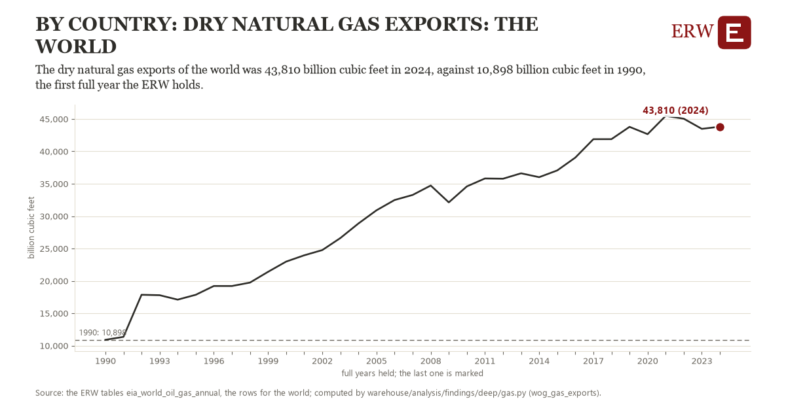

# By country: dry natural gas exports: the world

Draft `scan-deep-91917ef36f46` of the findings hunt over the whole warehouse (chain 502), 2026-11-19. State: draft, not reviewed. Review at `/internal/findings`.

**The finding.** The dry natural gas exports of the world were 43,810 billion cubic feet in 2024, against 10,898 billion cubic feet in 1990, the first full year the ERW holds.

**The figure by full year** (billion cubic feet): 1990: 10,898, 1991: 11,355, 1992: 17,855, 1993: 17,791, 1994: 17,102, 1995: 17,853, 1996: 19,210, 1997: 19,206, 1998: 19,737, 1999: 21,398, 2000: 22,977, 2001: 23,948, 2002: 24,756, 2003: 26,613, 2004: 28,862, 2005: 30,900, 2006: 32,487, 2007: 33,269, 2008: 34,724, 2009: 32,122, 2010: 34,591, 2011: 35,813, 2012: 35,775, 2013: 36,612, 2014: 36,013, 2015: 37,056, 2016: 39,039, 2017: 41,882, 2018: 41,886, 2019: 43,786, 2020: 42,659, 2021: 45,478, 2022: 45,044, 2023: 43,477, 2024: 43,810.

**The tables and rows.** `eia_world_oil_gas_annual`; the rows for the world, region key `wog_worl` (the card's `hunt.region`), years 1990 to 2024. The yearly values: `wog-gas-exports-wog-worl.csv`.

**Its strength.** The change is 18.90 typical yearly moves (a typical move is 1,741 billion cubic feet, 1.4826 times the median absolute change between full years). Holds in more than one year: 34 of the 34 full years after 1990 lie above 1990's value. Survives a change of window: from 1991 to 2024 the change is 32,455, from 1990 to 2023 it is 32,579. Sample large enough: 1990 holds 1 and 2024 holds 1 observations; the floor is 1. Half the change remains without the first year: from 1991 to 2024 the change is 32,455, 98.6 percent of the change from 1990. At least one typical yearly move: the change is 18.90 typical yearly moves (1,741 billion cubic feet a year, the median move between full years); the floor is 1.

**Its limits.** EIA's international energy data as the latest bulk file holds them; a country's recent years are often EIA's estimates; from 1980, when the series begin for every country.

**Reproduce.** `python wog-gas-exports-wog-worl.reproduce.py <the table's CSV>` and `do wog-gas-exports-wog-worl.reproduce.do` (Stata) recompute the figures by year from the tables as the public downloads hold them; each names the expected values at its top.
