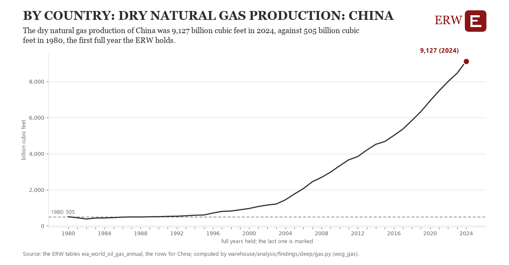

# By country: dry natural gas production: China

Draft `scan-deep-a9bbf9d408aa` of the findings hunt over the whole warehouse (chain 502), 2026-11-19. State: draft, not reviewed. Review at `/internal/findings`.

**The finding.** The dry natural gas production of China was 9,127 billion cubic feet in 2024, against 505 billion cubic feet in 1980, the first full year the ERW holds.

**The figure by full year** (billion cubic feet): 1980: 505, 1981: 450, 1982: 381, 1983: 431, 1984: 438, 1985: 457, 1986: 484, 1987: 494, 1988: 491, 1989: 505, 1990: 508, 1991: 526, 1992: 533, 1993: 558, 1994: 589, 1995: 601, 1996: 712, 1997: 801, 1998: 822, 1999: 889, 2000: 962, 2001: 1,070, 2002: 1,153, 2003: 1,211, 2004: 1,439, 2005: 1,763, 2006: 2,067, 2007: 2,446, 2008: 2,685, 2009: 2,975, 2010: 3,324, 2011: 3,655, 2012: 3,838, 2013: 4,194, 2014: 4,516, 2015: 4,671, 2016: 5,007, 2017: 5,359, 2018: 5,839, 2019: 6,333, 2020: 6,922, 2021: 7,479, 2022: 7,995, 2023: 8,454, 2024: 9,127.

**The tables and rows.** `eia_world_oil_gas_annual`; the rows for China, region key `wog_chn` (the card's `hunt.region`), years 1980 to 2024. The yearly values: `wog-gas-wog-chn.csv`.

**Its strength.** The change is 53.23 typical yearly moves (a typical move is 162 billion cubic feet, 1.4826 times the median absolute change between full years). Holds in more than one year: 35 of the 44 full years after 1980 lie above 1980's value. Survives a change of window: from 1981 to 2024 the change is 8,677, from 1980 to 2023 it is 7,949. Sample large enough: 1980 holds 1 and 2024 holds 1 observations; the floor is 1. Half the change remains without the first year: from 1981 to 2024 the change is 8,677, 100.6 percent of the change from 1980. At least one typical yearly move: the change is 53.23 typical yearly moves (162 billion cubic feet a year, the median move between full years); the floor is 1.

**Its limits.** EIA's international energy data as the latest bulk file holds them; a country's recent years are often EIA's estimates; from 1980, when the series begin for every country.

**Reproduce.** `python wog-gas-wog-chn.reproduce.py <the table's CSV>` and `do wog-gas-wog-chn.reproduce.do` (Stata) recompute the figures by year from the tables as the public downloads hold them; each names the expected values at its top.
