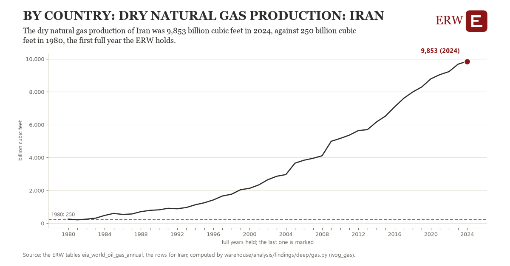

# By country: dry natural gas production: Iran

Draft `scan-deep-a94309fbefae` of the findings hunt over the whole warehouse (chain 502), 2026-11-19. State: draft, not reviewed. Review at `/internal/findings`.

**The finding.** The dry natural gas production of Iran was 9,853 billion cubic feet in 2024, against 250 billion cubic feet in 1980, the first full year the ERW holds.

**The figure by full year** (billion cubic feet): 1980: 250, 1981: 210, 1982: 250, 1983: 310, 1984: 476, 1985: 600, 1986: 536, 1987: 565, 1988: 706, 1989: 784, 1990: 818, 1991: 909, 1992: 883, 1993: 956, 1994: 1,123, 1995: 1,247, 1996: 1,420, 1997: 1,660, 1998: 1,766, 1999: 2,041, 2000: 2,127, 2001: 2,331, 2002: 2,649, 2003: 2,861, 2004: 2,963, 2005: 3,655, 2006: 3,836, 2007: 3,952, 2008: 4,107, 2009: 4,986, 2010: 5,161, 2011: 5,361, 2012: 5,640, 2013: 5,696, 2014: 6,162, 2015: 6,526, 2016: 7,083, 2017: 7,598, 2018: 7,988, 2019: 8,294, 2020: 8,788, 2021: 9,044, 2022: 9,226, 2023: 9,677, 2024: 9,853.

**The tables and rows.** `eia_world_oil_gas_annual`; the rows for Iran, region key `wog_irn` (the card's `hunt.region`), years 1980 to 2024. The yearly values: `wog-gas-wog-irn.csv`.

**Its strength.** The change is 37.19 typical yearly moves (a typical move is 258 billion cubic feet, 1.4826 times the median absolute change between full years). Holds in more than one year: 42 of the 44 full years after 1980 lie above 1980's value. Survives a change of window: from 1981 to 2024 the change is 9,643, from 1980 to 2023 it is 9,427. Sample large enough: 1980 holds 1 and 2024 holds 1 observations; the floor is 1. Half the change remains without the first year: from 1981 to 2024 the change is 9,643, 100.4 percent of the change from 1980. At least one typical yearly move: the change is 37.19 typical yearly moves (258 billion cubic feet a year, the median move between full years); the floor is 1.

**Its limits.** EIA's international energy data as the latest bulk file holds them; a country's recent years are often EIA's estimates; from 1980, when the series begin for every country.

**Reproduce.** `python wog-gas-wog-irn.reproduce.py <the table's CSV>` and `do wog-gas-wog-irn.reproduce.do` (Stata) recompute the figures by year from the tables as the public downloads hold them; each names the expected values at its top.
