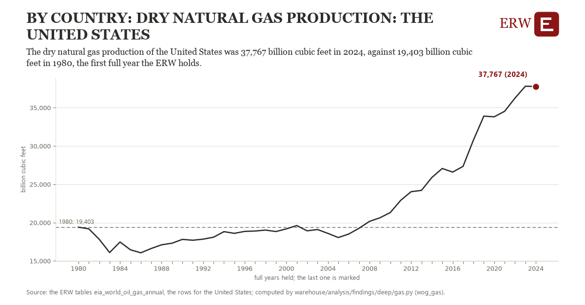

# By country: dry natural gas production: the United States

Draft `scan-deep-684a81e89b92` of the findings hunt over the whole warehouse (chain 502), 2026-11-19. State: draft, not reviewed. Review at `/internal/findings`.

**The finding.** The dry natural gas production of the United States was 37,767 billion cubic feet in 2024, against 19,403 billion cubic feet in 1980, the first full year the ERW holds.

**The figure by full year** (billion cubic feet): 1980: 19,403, 1981: 19,181, 1982: 17,820, 1983: 16,094, 1984: 17,466, 1985: 16,454, 1986: 16,059, 1987: 16,621, 1988: 17,103, 1989: 17,311, 1990: 17,810, 1991: 17,698, 1992: 17,840, 1993: 18,095, 1994: 18,821, 1995: 18,599, 1996: 18,854, 1997: 18,902, 1998: 19,024, 1999: 18,832, 2000: 19,182, 2001: 19,616, 2002: 18,928, 2003: 19,099, 2004: 18,591, 2005: 18,051, 2006: 18,504, 2007: 19,266, 2008: 20,159, 2009: 20,624, 2010: 21,316, 2011: 22,902, 2012: 24,033, 2013: 24,206, 2014: 25,890, 2015: 27,065, 2016: 26,592, 2017: 27,341, 2018: 30,774, 2019: 33,899, 2020: 33,811, 2021: 34,529, 2022: 36,255, 2023: 37,803, 2024: 37,767.

**The tables and rows.** `eia_world_oil_gas_annual`; the rows for the United States, region key `wog_usa` (the card's `hunt.region`), years 1980 to 2024. The yearly values: `wog-gas-wog-usa.csv`.

**Its strength.** The change is 24.61 typical yearly moves (a typical move is 746 billion cubic feet, 1.4826 times the median absolute change between full years). Holds in more than one year: 18 of the 44 full years after 1980 lie above 1980's value. Survives a change of window: from 1981 to 2024 the change is 18,585, from 1980 to 2023 it is 18,400. Sample large enough: 1980 holds 1 and 2024 holds 1 observations; the floor is 1. Half the change remains without the first year: from 1981 to 2024 the change is 18,585, 101.2 percent of the change from 1980. At least one typical yearly move: the change is 24.61 typical yearly moves (746 billion cubic feet a year, the median move between full years); the floor is 1.

**Its limits.** EIA's international energy data as the latest bulk file holds them; a country's recent years are often EIA's estimates; from 1980, when the series begin for every country.

**Reproduce.** `python wog-gas-wog-usa.reproduce.py <the table's CSV>` and `do wog-gas-wog-usa.reproduce.do` (Stata) recompute the figures by year from the tables as the public downloads hold them; each names the expected values at its top.
